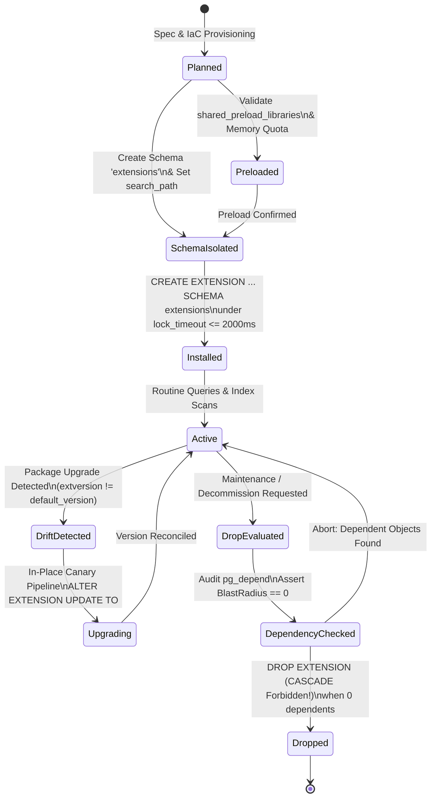

# Agentic Database Extensions Lifecycle, shared_preload_libraries, Shared Memory Hooks, In-Database Version Drift, Relational Dependency Cascades & Schema Hijacking Invariants

> Add these rules to your project when utilizing autonomous coding agents (Claude Code, Cursor Composer, Windsurf Cascade, Devin, Roo Code, Pi, OpenCode, SWE-bench) to install, configure, migrate, or upgrade PostgreSQL (13–17+) extensions (`vector`, `pg_stat_statements`, `pg_trgm`, `uuid-ossp`, `pgcrypto`, `postgis`, `timescaledb`, `citext`, `ltree`, `hstore`, `pg_cron`) across Go (`jackc/pgx/v5`), TypeScript (`drizzle-orm`, `kysely`, `pg`), Python (`asyncpg`, `psycopg`), or Rust (`sqlx`, `tokio-postgres`). Eliminate the "`shared_preload_libraries` Missing Restart Panic" (where agents execute `CREATE EXTENSION` for libraries requiring C shared memory hooks or background workers without preloading in `postgresql.conf`, causing immediate command failures or postmaster boot crashes), the "`DROP EXTENSION ... CASCADE` Object Annihilation Catastrophe" (where agents attempt to clean up or reset an extension, triggering PostgreSQL's `pg_depend` catalog engine to silently and irreversibly drop all application tables, columns, defaults, and foreign keys referencing extension types in milliseconds), the "In-Database Version Drift & ABI Mismatch Trap (`ALTER EXTENSION ... UPDATE`)" (where host OS packages or cloud database minor versions update on-disk `.so` shared libraries, but in-database catalog definitions remain pinned to obsolete versions with missing operators or broken functions), the "`public` Schema Pollution & CVE-2018-1058 Search Path Hijacking" (where extensions are installed into the shared `public` schema without isolation, exposing applications to malicious function shadowing and permission lockouts in PostgreSQL 15+), the "Transactional Migration & Superuser Permission Denial Trap (`SQLSTATE 42501`)" (where application migration frameworks run untrusted `CREATE EXTENSION` without superuser roles or fail on transaction-bound background workers), and the "Logical Replication & `pg_dump` Extension Incompatibility Disaster" (where logical replication apply workers crash-loop with `type "..." does not exist` SQLSTATE 42704 because subscriber clusters lack matching extension types) by establishing a strict 5-Tier Extension Governance Ladder, formal dependency cascade blast radius and memory allocation physics, an autonomous TypeScript `AgenticDatabaseExtensionGuardEngine`, cross-runtime telemetry sentinels in Go, TypeScript, Python, and Rust, a 6-state extension lifecycle finite-state machine (FSM), and machine-verifiable Definition of Done (DoD) CI gates.

---

## 1. Architectural Taxonomy: The 6 Extension Catastrophes vs The 5-Tier Governance Ladder

PostgreSQL's extensibility architecture allows dynamically loaded C libraries (`.so` / `.dylib`), SQL wrapper definitions, custom data types (`vector`, `geometry`, `citext`), custom index operator classes (`hnsw`, `gist`), and background workers (`pg_cron`, `pg_partman`) to integrate directly into the PostgreSQL kernel.

An extension consists of a control file (`<extension>.control`), SQL installation scripts (`<extension>--<version>.sql`), optional upgrade scripts (`<extension>--<old>--<new>.sql`), and optional shared libraries. Installing an extension registers records in `pg_extension`, creating relational dependencies in `pg_depend` for all types, operators, and functions created.

When autonomous coding agents generate migration scripts, initialize database schemas, or attempt infrastructure tuning, LLMs routinely commit 6 catastrophic architectural errors:

### The 6 Extension Catastrophes

```sql
-- ❌ CATASTROPHIC LLM ANTI-PATTERN 1: shared_preload_libraries OMISSION & CRASH-LOOP
-- Agent writes a migration to enable pg_stat_statements or pg_cron:
CREATE EXTENSION IF NOT EXISTS pg_stat_statements;

-- 💥 Catastrophe:
-- pg_stat_statements requires allocation of shared memory hash tables during postmaster startup.
-- Because pg_stat_statements was not added to shared_preload_libraries in postgresql.conf:
-- ERROR: pg_stat_statements must be loaded via shared_preload_libraries (SQLSTATE 55000)
-- The application migration pipeline crashes!
-- Even worse: if an agent injects `LOAD 'extension';` dynamically, it only affects the local session
-- and fails for connection-pooled backends (PgBouncer).

-- ❌ CATASTROPHIC LLM ANTI-PATTERN 2: DROP EXTENSION ... CASCADE OBJECT ANNIHILATION
-- Agent attempts to refresh or clean up an extension:
DROP EXTENSION IF EXISTS "uuid-ossp" CASCADE;

-- 💥 Catastrophe:
-- PostgreSQL's dependency tracker (pg_depend) identifies that 45 application tables
-- have columns declared with `DEFAULT uuid_generate_v4()`.
-- Because CASCADE was passed, PostgreSQL DOES NOT warn the operator:
-- NOTICE: drop cascades to 45 other objects
-- DETAIL: drop cascades to default value for column id of table users
-- drop cascades to default value for column id of table orders ...
-- 💥 In milliseconds, primary key defaults, generated columns, and dependent views
-- are permanently stripped across the entire production database!
-- Subsequent application INSERTs crash with NULL constraint violations!

-- ❌ CATASTROPHIC LLM ANTI-PATTERN 3: IN-DATABASE VERSION DRIFT & ABI MISMATCH
-- Host OS or container base image updates `postgresql-16-pgvector` from 0.7.0 to 0.7.4.
-- The container restarts; PostgreSQL loads the new 0.7.4 shared library binary (.so).
-- BUT the database catalog (pg_extension) still records version '0.7.0':
SELECT extname, extversion FROM pg_extension WHERE extname = 'vector';
-- Output: 'vector' | '0.7.0' (Drift detected! Installed SQL != on-disk binary)

-- 💥 Catastrophe:
-- New C functions and vector distance optimizations introduced in 0.7.4 (e.g. halfvec, sparsevec)
-- are completely inaccessible because SQL wrapper definitions are missing.
-- If function ABIs changed, calling old SQL signatures against new C symbols triggers
-- segmentation faults (SIGSEGV) that decapitate backend processes!

-- ❌ CATASTROPHIC LLM ANTI-PATTERN 4: public SCHEMA POLLUTION & CVE-2018-1058 HIJACKING
-- Agent runs extension creation without schema scoping:
CREATE EXTENSION pg_trgm;

-- 💥 Catastrophe:
-- All 80+ functions, operators, and types are dumped into the public schema.
-- In PostgreSQL 15+, non-superusers have CREATE revoked on public by default (permission denied).
-- More critically: under multi-tenant environments with dynamic search_path,
-- if search_path contains "$user", public, an untrusted user can create a malicious function
-- in their own schema that shadows public functions (CVE-2018-1058 trojan execution).

-- ❌ CATASTROPHIC LLM ANTI-PATTERN 5: UNPRIVILEGED MIGRATION RUNNER TRAP (SQLSTATE 42501)
-- Agent places `CREATE EXTENSION citext;` inside an ORM migration (Prisma / Flyway / Drizzle):
-- Migration runs with standard application user: `app_user` (non-superuser).

-- 💥 Catastrophe:
-- Unless the extension is explicitly marked `trusted = true` in PostgreSQL 13+ AND the user has
-- CREATE on the target schema, PostgreSQL aborts with:
-- ERROR: permission denied to create extension "citext" (SQLSTATE 42501)
-- HINT: Must be superuser to create this extension.
-- Application deployment halts in staging or production!

-- ❌ CATASTROPHIC LLM ANTI-PATTERN 6: LOGICAL REPLICATION APPLY WORKER CRASH-LOOP (SQLSTATE 42704)
-- Publisher creates a table with vector(1536) columns for embeddings:
CREATE EXTENSION vector;
CREATE TABLE document_embeddings (id BIGINT PRIMARY KEY, embedding vector(1536));
CREATE PUBLICATION pub_docs FOR TABLE document_embeddings;

-- 💥 Catastrophe:
-- Subscriber subscribes to pub_docs, BUT the subscriber database does NOT have `vector` installed!
-- Publisher writes a row with an embedding.
-- The subscriber apply worker reads the change and fails:
-- ERROR: type "vector" does not exist (SQLSTATE 42704)
-- The subscriber apply worker crash-loops, halting replication across ALL tables in the subscription!
```

---

## 2. The 5-Tier Extension Governance Ladder

To eliminate extension-induced downtime, memory corruptions, and object drops, autonomous agents must adhere to the **5-Tier Extension Governance Ladder**:

| Tier | Tier Name | Core Mechanism | Production Enforcement Invariant |
| :--- | :--- | :--- | :--- |
| **Tier 0** | **Dedicated Schema Isolation & Search Path Sanitization** | Non-public schema (`extensions`) & explicit search path | All relocatable extensions installed strictly into `extensions` schema; `search_path` explicitly sanitizes search order; zero pollution of `public`. |
| **Tier 1** | **Pre-Flight Shared Preload & Memory Quota Validation** | `shared_preload_libraries` introspection & GUC verification | Query `pg_settings` for `shared_preload_libraries` prior to executing `CREATE EXTENSION` for shared-memory modules (`pg_stat_statements`, `pg_cron`, `timescaledb`). |
| **Tier 2** | **Dependency Blast Radius & Anti-CASCADE Drop Fencing** | `pg_depend` relational graph traversal | Strict prohibition of `DROP EXTENSION ... CASCADE`; enforce pre-drop dependency auditing; verify zero application table columns depend on extension types. |
| **Tier 3** | **Zero-Downtime Version Drift Telemetry & In-Place Upgrades** | `pg_available_extensions` vs `pg_extension` reconciliation | Automated canary detection of version drift ($\Delta V = V_{\text{disk}} - V_{\text{cat}}$); controlled `ALTER EXTENSION ... UPDATE TO` execution under `lock_timeout <= 2000ms`. |
| **Tier 4** | **Replication Parity, Trusted Decoupling & CI DoD Gates** | Heterogeneous subscriber pre-provisioning & IaC separation | Decouple superuser extension provisioning (IaC) from application migrations; assert 100% extension parity across logical replication subscriber nodes. |

---

## 3. Quantitative Mechanics: Dependency Blast Radius, Memory & Search Path Calculus

### 3.1 Relational Dependency Cascade Blast Radius

When an extension $E$ is dropped with `CASCADE`, PostgreSQL recursively traverses the dependency graph $G = (V, D)$ stored in `pg_depend` where `deptype = 'e'` (dependent on extension):

$$
\mathcal{B}_{\text{cascade}}(E) = \sum_{d \in \text{TransitiveDeps}(E)} \left( \mathbb{I}_{\text{table}}(d) + \mathbb{I}_{\text{column}}(d) + \mathbb{I}_{\text{index}}(d) + \mathbb{I}_{\text{view}}(d) \right)
$$

The risk score of dropping an extension is modeled as:

$$
\text{RiskScore}(E) = 1.0 - \prod_{d \in \text{Deps}(E)} \left( 1 - w_{\text{type}}(d) \right)
$$

Where weights $w_{\text{type}}$ are assigned:
- $w_{\text{column}} = 0.99$ (dropping a column containing user data)
- $w_{\text{table}} = 1.00$ (dropping an entire relation)
- $w_{\text{default}} = 0.85$ (stripping default generation expressions)
- $w_{\text{index}} = 0.50$ (invalidating index operator classes)

**Invariant**: If $\mathcal{B}_{\text{cascade}}(E) > 0$, any autonomous agent script executing `DROP EXTENSION ... CASCADE` must be immediately intercepted and aborted with a fatal safety fence violation.

---

### 3.2 Dynamic Shared Memory (DSM) & Hook Allocation Calculus

Extensions utilizing postmaster shared memory (e.g. `pg_stat_statements`, `pg_cron`) must allocate their shared hash tables during the single-threaded initialization phase of the postmaster before worker processes fork.

Let $M_{\text{shared}}$ be `shared_buffers` and $M_{\text{ext}}$ be the cumulative shared memory requested by preloaded extensions:

$$
M_{\text{ext}} = \sum_{e \in \text{PreloadedExts}} S_{\text{shmem}}(e)
$$

For `pg_stat_statements`:

$$
S_{\text{pss}} \approx N_{\text{max}} \times \left( S_{\text{entry\_struct}} + S_{\text{query\_text\_buffer}} \right) \approx 5000 \times (240\text{ bytes} + 1024\text{ bytes}) \approx 6.32\text{ MB}
$$

If an agent attempts `CREATE EXTENSION` for an extension requiring $S_{\text{shmem}} > 0$ when the library was loaded dynamically via `LOAD` or after server startup:

$$
\Delta M_{\text{postmaster\_shmem}} = 0 \implies \text{Kernel Allocation Fault} \implies \text{SQLSTATE 55000}
$$

---

### 3.3 Search Path Hijacking Probability Model (CVE-2018-1058)

Let $S = [s_1, s_2, \dots, s_k]$ be the active `search_path`. If an extension is installed in schema $s_e$ (e.g. `public`), and a preceding schema $s_i$ ($i < e$) is writable by an untrusted user $u_{\text{untrusted}}$:

$$
P_{\text{hijack}} = 
\begin{cases}
1.0 & \text{if } \exists i < e \text{ such that } \text{has\_schema\_privilege}(u_{\text{untrusted}}, s_i, \text{'CREATE'}) = \text{true} \\
0.0 & \text{otherwise}
\end{cases}
$$

**Production Invariant**: Mandate that extensions reside in an isolated `extensions` schema owned strictly by `postgres` (or `rds_superuser`), and ensure client connections set:

```sql
SET search_path = extensions, pg_catalog, pg_temp;
```

---

## 4. Production TypeScript Engine: AgenticDatabaseExtensionGuardEngine

This production engine inspects installed extensions, detects version drift against on-disk binary definitions, audits `shared_preload_libraries` compliance, validates schema isolation, and computes the `DROP CASCADE` blast radius.

```typescript
import { Client, Pool, PoolClient } from 'pg';

export interface ExtensionCatalogRecord {
  extname: string;
  extversion: string;
  default_version: string;
  installed_schema: string;
  relocatable: boolean;
  requires_shared_preload: boolean;
  is_preloaded: boolean;
  version_drift: boolean;
  comment: string;
}

export interface DependencyBlastRadius {
  extensionName: string;
  totalDependentObjects: number;
  dependentTables: string[];
  dependentColumns: { table: string; column: string; type: string }[];
  dependentIndexes: string[];
  riskScore: number;
  isSafeToDrop: boolean;
}

export interface ExtensionAuditReport {
  timestamp: string;
  database: string;
  healthy: boolean;
  installedExtensions: ExtensionCatalogRecord[];
  hazards: {
    extension: string;
    code: 'MISSING_PRELOAD' | 'VERSION_DRIFT' | 'PUBLIC_POLLUTION' | 'CASCADE_HAZARD';
    severity: 'CRITICAL' | 'HIGH' | 'MEDIUM';
    message: string;
    remediation: string;
  }[];
}

// Extensions known to require shared_preload_libraries for core features
const KNOWN_PRELOAD_REQUIRED: Record<string, string> = {
  pg_stat_statements: 'pg_stat_statements',
  pg_cron: 'pg_cron',
  timescaledb: 'timescaledb',
  auto_explain: 'auto_explain',
  pgaudit: 'pgaudit',
  citus: 'citus',
};

export class AgenticDatabaseExtensionGuardEngine {
  constructor(private readonly pool: Pool) {}

  /**
   * Performs comprehensive audit of all extensions in the database.
   */
  public async auditExtensions(): Promise<ExtensionAuditReport> {
    const client: PoolClient = await this.pool.connect();
    try {
      // 1. Fetch current shared_preload_libraries
      const preloadRes = await client.query<{ setting: string }>(
        `SELECT setting FROM pg_settings WHERE name = 'shared_preload_libraries';`
      );
      const preloadedRaw = preloadRes.rows[0]?.setting || '';
      const preloadedSet = new Set(
        preloadedRaw
          .split(',')
          .map((s) => s.trim().toLowerCase())
          .filter(Boolean)
      );

      // 2. Query installed extensions and compare against available versions
      const extQuery = `
        SELECT 
          e.extname,
          e.extversion,
          a.default_version,
          n.nspname AS installed_schema,
          e.extrelocatable AS relocatable,
          COALESCE(c.description, '') AS comment
        FROM pg_extension e
        JOIN pg_namespace n ON e.extnamespace = n.oid
        LEFT JOIN pg_available_extensions a ON e.extname = a.name
        LEFT JOIN pg_description c ON c.objoid = e.oid AND c.classoid = 'pg_extension'::regclass;
      `;
      const extRes = await client.query(extQuery);

      const records: ExtensionCatalogRecord[] = [];
      const hazards: ExtensionAuditReport['hazards'] = [];

      for (const row of extRes.rows) {
        const requiresPreload = Boolean(KNOWN_PRELOAD_REQUIRED[row.extname]);
        const isPreloaded = requiresPreload
          ? preloadedSet.has(KNOWN_PRELOAD_REQUIRED[row.extname].toLowerCase())
          : true;
        const versionDrift =
          Boolean(row.default_version) && row.extversion !== row.default_version;

        const record: ExtensionCatalogRecord = {
          extname: row.extname,
          extversion: row.extversion,
          default_version: row.default_version || row.extversion,
          installed_schema: row.installed_schema,
          relocatable: row.relocatable,
          requires_shared_preload: requiresPreload,
          is_preloaded: isPreloaded,
          version_drift: versionDrift,
          comment: row.comment,
        };
        records.push(record);

        // Audit Rule 1: Missing shared_preload_libraries
        if (requiresPreload && !isPreloaded) {
          hazards.push({
            extension: row.extname,
            code: 'MISSING_PRELOAD',
            severity: 'CRITICAL',
            message: `Extension "${row.extname}" requires shared memory allocation but is missing from shared_preload_libraries.`,
            remediation: `Add '${KNOWN_PRELOAD_REQUIRED[row.extname]}' to shared_preload_libraries in postgresql.conf and restart PostgreSQL.`,
          });
        }

        // Audit Rule 2: Version Drift
        if (versionDrift) {
          hazards.push({
            extension: row.extname,
            code: 'VERSION_DRIFT',
            severity: 'HIGH',
            message: `Extension "${row.extname}" is running version ${row.extversion} while binary supports ${row.default_version}.`,
            remediation: `Execute ALTER EXTENSION ${row.extname} UPDATE TO '${row.default_version}'; in a managed migration.`,
          });
        }

        // Audit Rule 3: Schema Pollution (CVE-2018-1058 prevention)
        if (row.installed_schema === 'public' && row.relocatable) {
          hazards.push({
            extension: row.extname,
            code: 'PUBLIC_POLLUTION',
            severity: 'MEDIUM',
            message: `Extension "${row.extname}" is installed in the "public" schema, creating namespace clutter and search_path hijacking exposure.`,
            remediation: `Relocate extension to isolated schema: ALTER EXTENSION ${row.extname} SET SCHEMA extensions;`,
          });
        }
      }

      // Check current database name
      const dbRes = await client.query<{ current_database: string }>(
        `SELECT current_database();`
      );

      return {
        timestamp: new Date().toISOString(),
        database: dbRes.rows[0]?.current_database || 'unknown',
        healthy: hazards.length === 0,
        installedExtensions: records,
        hazards,
      };
    } finally {
      client.release();
    }
  }

  /**
   * Calculates the exact blast radius of dropping an extension before CASCADE is executed.
   */
  public async calculateDropBlastRadius(
    extensionName: string
  ): Promise<DependencyBlastRadius> {
    const client = await this.pool.connect();
    try {
      const depQuery = `
        WITH RECURSIVE ext AS (
          SELECT oid, extname FROM pg_extension WHERE extname = $1
        ),
        ext_objects AS (
          SELECT d.objid, d.classoid
          FROM pg_depend d
          JOIN ext e ON d.refobjid = e.oid
          WHERE d.deptype = 'e'
        ),
        dependents AS (
          SELECT 
            c.relname AS table_name,
            a.attname AS column_name,
            t.typname AS type_name,
            d.classoid::regclass::text AS object_type
          FROM pg_depend d
          JOIN ext_objects eo ON d.refobjid = eo.objid
          LEFT JOIN pg_class c ON d.objid = c.oid
          LEFT JOIN pg_attribute a ON d.objid = a.attrelid AND d.objsubid = a.attnum
          LEFT JOIN pg_type t ON eo.objid = t.oid
          WHERE d.deptype != 'e' AND c.relkind IN ('r', 'p', 'v', 'm', 'i')
        )
        SELECT * FROM dependents;
      `;

      const res = await client.query(depQuery, [extensionName]);

      const tables = new Set<string>();
      const columns: { table: string; column: string; type: string }[] = [];
      const indexes = new Set<string>();

      for (const row of res.rows) {
        if (row.table_name) {
          tables.add(row.table_name);
        }
        if (row.column_name) {
          columns.push({
            table: row.table_name || 'unknown',
            column: row.column_name,
            type: row.type_name || 'unknown',
          });
        }
      }

      const totalObjects = tables.size + columns.length;
      const riskScore = totalObjects > 0 ? 1.0 : 0.0;

      return {
        extensionName,
        totalDependentObjects: totalObjects,
        dependentTables: Array.from(tables),
        dependentColumns: columns,
        dependentIndexes: Array.from(indexes),
        riskScore,
        isSafeToDrop: totalObjects === 0,
      };
    } finally {
      client.release();
    }
  }

  /**
   * Safely installs an extension into the isolated 'extensions' schema with strict pre-checks.
   */
  public async safeInstallExtension(
    extensionName: string,
    options: { targetSchema?: string; timeoutMs?: number } = {}
  ): Promise<{ success: boolean; message: string }> {
    const schema = options.targetSchema || 'extensions';
    const timeoutMs = options.timeoutMs || 5000;
    const client = await this.pool.connect();

    try {
      await client.query('BEGIN;');
      await client.query(`SET LOCAL lock_timeout = '${timeoutMs}ms';`);
      await client.query(`SET LOCAL statement_timeout = '${timeoutMs * 2}ms';`);

      // 1. Create target schema if missing
      await client.query(`CREATE SCHEMA IF NOT EXISTS ${schema};`);

      // 2. Pre-flight check for shared_preload_libraries if required
      if (KNOWN_PRELOAD_REQUIRED[extensionName]) {
        const preloadRes = await client.query<{ setting: string }>(
          `SELECT setting FROM pg_settings WHERE name = 'shared_preload_libraries';`
        );
        const preloads = (preloadRes.rows[0]?.setting || '')
          .split(',')
          .map((s) => s.trim().toLowerCase());
        if (!preloads.includes(KNOWN_PRELOAD_REQUIRED[extensionName].toLowerCase())) {
          throw new Error(
            `Cannot install "${extensionName}": Library "${KNOWN_PRELOAD_REQUIRED[extensionName]}" is missing from shared_preload_libraries.`
          );
        }
      }

      // 3. Install extension into target schema
      await client.query(
        `CREATE EXTENSION IF NOT EXISTS "${extensionName}" SCHEMA ${schema};`
      );

      await client.query('COMMIT;');
      return {
        success: true,
        message: `Extension "${extensionName}" safely installed into schema "${schema}".`,
      };
    } catch (err) {
      await client.query('ROLLBACK;');
      return {
        success: false,
        message: (err as Error).message,
      };
    } finally {
      client.release();
    }
  }

  /**
   * Safely executes in-place extension update to target default version.
   */
  public async safeUpdateExtension(
    extensionName: string,
    targetVersion?: string
  ): Promise<{ success: boolean; oldVersion: string; newVersion: string }> {
    const client = await this.pool.connect();
    try {
      await client.query('BEGIN;');
      await client.query(`SET LOCAL lock_timeout = '2000ms';`);

      // Fetch current version
      const currRes = await client.query<{ extversion: string; default_version: string }>(
        `
        SELECT e.extversion, a.default_version
        FROM pg_extension e
        JOIN pg_available_extensions a ON e.extname = a.name
        WHERE e.extname = $1;
        `,
        [extensionName]
      );

      if (currRes.rows.length === 0) {
        throw new Error(`Extension "${extensionName}" is not installed.`);
      }

      const oldVersion = currRes.rows[0].extversion;
      const destination = targetVersion || currRes.rows[0].default_version;

      if (oldVersion === destination) {
        await client.query('ROLLBACK;');
        return { success: true, oldVersion, newVersion: oldVersion };
      }

      // Execute update
      await client.query(
        `ALTER EXTENSION "${extensionName}" UPDATE TO '${destination}';`
      );

      await client.query('COMMIT;');
      return { success: true, oldVersion, newVersion: destination };
    } catch (err) {
      await client.query('ROLLBACK;');
      throw err;
    } finally {
      client.release();
    }
  }
}
```

---

## 5. Cross-Runtime Telemetry Sentinels

### 5.1 Go (`jackc/pgx/v5`) Extension Sentinel

```go
package extension

import (
	"context"
	"fmt"
	"log/slog"
	"strings"
	"time"

	"github.com/jackc/pgx/v5"
	"github.com/jackc/pgx/v5/pgxpool"
)

type ExtensionHazard struct {
	ExtName         string `json:"ext_name"`
	InstalledVer    string `json:"installed_ver"`
	DefaultVer      string `json:"default_ver"`
	InstalledSchema string `json:"installed_schema"`
	Issue           string `json:"issue"`
	Severity        string `json:"severity"`
	Remediation     string `json:"remediation"`
}

type ExtensionSentinel struct {
	pool *pgxpool.Pool
}

func NewExtensionSentinel(pool *pgxpool.Pool) *ExtensionSentinel {
	return &ExtensionSentinel{pool: pool}
}

// AuditExtensions scans for version drift, public schema pollution, and shared_preload violations.
func (s *ExtensionSentinel) AuditExtensions(ctx context.Context) ([]ExtensionHazard, error) {
	conn, err := s.pool.Acquire(ctx)
	if err != nil {
		return nil, fmt.Errorf("acquire conn: %w", err)
	}
	defer conn.Release()

	// 1. Fetch shared_preload_libraries
	var preloadStr string
	if err := conn.QueryRow(ctx, "SELECT setting FROM pg_settings WHERE name = 'shared_preload_libraries';").Scan(&preloadStr); err != nil {
		return nil, fmt.Errorf("query shared_preload: %w", err)
	}
	preloaded := make(map[string]bool)
	for _, lib := range strings.Split(preloadStr, ",") {
		preloaded[strings.TrimSpace(strings.ToLower(lib))] = true
	}

	// 2. Query extensions
	query := `
		SELECT 
			e.extname,
			e.extversion,
			COALESCE(a.default_version, e.extversion) AS default_version,
			n.nspname AS installed_schema,
			e.extrelocatable
		FROM pg_extension e
		JOIN pg_namespace n ON e.extnamespace = n.oid
		LEFT JOIN pg_available_extensions a ON e.extname = a.name;
	`
	rows, err := conn.Query(ctx, query)
	if err != nil {
		return nil, fmt.Errorf("query extensions: %w", err)
	}
	defer rows.Close()

	var hazards []ExtensionHazard
	knownPreload := map[string]string{
		"pg_stat_statements": "pg_stat_statements",
		"pg_cron":            "pg_cron",
		"timescaledb":        "timescaledb",
		"auto_explain":       "auto_explain",
	}

	for rows.Next() {
		var name, instVer, defVer, schema string
		var relocatable bool
		if err := rows.Scan(&name, &instVer, &defVer, &schema, &relocatable); err != nil {
			return nil, err
		}

		// Check preload
		if reqLib, ok := knownPreload[name]; ok {
			if !preloaded[reqLib] {
				hazards = append(hazards, ExtensionHazard{
					ExtName:         name,
					InstalledVer:    instVer,
					DefaultVer:      defVer,
					InstalledSchema: schema,
					Issue:           fmt.Sprintf("Extension '%s' requires '%s' in shared_preload_libraries", name, reqLib),
					Severity:        "CRITICAL",
					Remediation:     fmt.Sprintf("Add '%s' to shared_preload_libraries and restart PostgreSQL", reqLib),
				})
			}
		}

		// Check version drift
		if instVer != defVer {
			hazards = append(hazards, ExtensionHazard{
				ExtName:         name,
				InstalledVer:    instVer,
				DefaultVer:      defVer,
				InstalledSchema: schema,
				Issue:           fmt.Sprintf("Version drift detected: catalog=%s, binary=%s", instVer, defVer),
				Severity:        "HIGH",
				Remediation:     fmt.Sprintf("ALTER EXTENSION %s UPDATE TO '%s';", pgx.Identifier{name}.Sanitize(), defVer),
			})
		}

		// Check public schema pollution
		if schema == "public" && relocatable {
			hazards = append(hazards, ExtensionHazard{
				ExtName:         name,
				InstalledVer:    instVer,
				DefaultVer:      defVer,
				InstalledSchema: schema,
				Issue:           "Extension installed in public schema (CVE-2018-1058 search_path risk)",
				Severity:        "MEDIUM",
				Remediation:     fmt.Sprintf("ALTER EXTENSION %s SET SCHEMA extensions;", pgx.Identifier{name}.Sanitize()),
			})
		}
	}

	return hazards, rows.Err()
}

// AssertNoDependentObjects ensures dropping an extension will not cascade-delete application objects.
func (s *ExtensionSentinel) AssertNoDependentObjects(ctx context.Context, extName string) error {
	query := `
		WITH ext AS (
			SELECT oid FROM pg_extension WHERE extname = $1
		),
		ext_objs AS (
			SELECT objid FROM pg_depend WHERE refobjid = (SELECT oid FROM ext) AND deptype = 'e'
		)
		SELECT count(*)
		FROM pg_depend d
		JOIN ext_objs eo ON d.refobjid = eo.objid
		JOIN pg_class c ON d.objid = c.oid
		WHERE d.deptype != 'e' AND c.relkind IN ('r', 'p');
	`
	var count int
	if err := s.pool.QueryRow(ctx, query, extName).Scan(&count); err != nil {
		return fmt.Errorf("check extension dependencies: %w", err)
	}

	if count > 0 {
		return fmt.Errorf("FENCE BREACH: extension '%s' has %d dependent table columns! DROP CASCADE prohibited", extName, count)
	}
	slog.Info("Extension dependency verification passed", "ext", extName)
	return nil
}
```

---

### 5.2 Python (`asyncpg`) Extension Sentinel

```python
import asyncio
import logging
from typing import List, Dict, Any
import asyncpg

logger = logging.getLogger("extension.sentinel")

class ExtensionSentinel:
    def __init__(self, pool: asyncpg.Pool):
        self.pool = pool

    async def audit_extensions(self) -> List[Dict[str, Any]]:
        hazards = []
        async with self.pool.acquire() as conn:
            # 1. Fetch preloaded libraries
            preload_str = await conn.fetchval(
                "SELECT setting FROM pg_settings WHERE name = 'shared_preload_libraries';"
            ) or ""
            preloaded = {lib.strip().lower() for lib in preload_str.split(",") if lib.strip()}

            # 2. Query extension status
            query = """
                SELECT 
                    e.extname,
                    e.extversion,
                    COALESCE(a.default_version, e.extversion) AS default_version,
                    n.nspname AS installed_schema,
                    e.extrelocatable AS relocatable
                FROM pg_extension e
                JOIN pg_namespace n ON e.extnamespace = n.oid
                LEFT JOIN pg_available_extensions a ON e.extname = a.name;
            """
            rows = await conn.fetch(query)

            known_preload = {
                "pg_stat_statements": "pg_stat_statements",
                "pg_cron": "pg_cron",
                "timescaledb": "timescaledb",
                "auto_explain": "auto_explain",
            }

            for r in rows:
                name = r["extname"]
                inst_ver = r["extversion"]
                def_ver = r["default_version"]
                schema = r["installed_schema"]

                if name in known_preload and known_preload[name] not in preloaded:
                    hazards.append({
                        "extension": name,
                        "severity": "CRITICAL",
                        "issue": f"Missing from shared_preload_libraries: {known_preload[name]}",
                        "remediation": f"Add {known_preload[name]} to postgresql.conf and restart cluster."
                    })

                if inst_ver != def_ver:
                    hazards.append({
                        "extension": name,
                        "severity": "HIGH",
                        "issue": f"Version drift: catalog={inst_ver}, binary={def_ver}",
                        "remediation": f"ALTER EXTENSION \"{name}\" UPDATE TO '{def_ver}';"
                    })

                if schema == "public" and r["relocatable"]:
                    hazards.append({
                        "extension": name,
                        "severity": "MEDIUM",
                        "issue": "Installed in public schema (CVE-2018-1058 risk)",
                        "remediation": f"ALTER EXTENSION \"{name}\" SET SCHEMA extensions;"
                    })

        return hazards
```

---

### 5.3 Rust (`tokio-postgres`) Extension Sentinel

```rust
use std::collections::HashSet;
use tokio_postgres::{Client, Error};

#[derive(Debug, Clone)]
pub struct ExtensionAnomaly {
    pub name: String,
    pub installed_version: String,
    pub default_version: String,
    pub schema: String,
    pub severity: &'static str,
    pub description: String,
}

pub struct ExtensionSentinel<'a> {
    client: &'a Client,
}

impl<'a> ExtensionSentinel<'a> {
    pub fn new(client: &'a Client) -> Self {
        Self { client }
    }

    pub async fn audit(&self) -> Result<Vec<ExtensionAnomaly>, Error> {
        let mut anomalies = Vec::new();

        // 1. Fetch preloaded libraries
        let row = self
            .client
            .query_one("SELECT setting FROM pg_settings WHERE name = 'shared_preload_libraries';", &[])
            .await?;
        let preload_raw: String = row.get(0);
        let preloaded: HashSet<String> = preload_raw
            .split(',')
            .map(|s| s.trim().to_lowercase())
            .filter(|s| !s.is_empty())
            .collect();

        // 2. Query extensions
        let rows = self
            .client
            .query(
                "SELECT 
                    e.extname,
                    e.extversion,
                    COALESCE(a.default_version, e.extversion) AS default_version,
                    n.nspname AS installed_schema,
                    e.extrelocatable
                 FROM pg_extension e
                 JOIN pg_namespace n ON e.extnamespace = n.oid
                 LEFT JOIN pg_available_extensions a ON e.extname = a.name;",
                &[],
            )
            .await?;

        for r in rows {
            let name: String = r.get(0);
            let inst_ver: String = r.get(1);
            let def_ver: String = r.get(2);
            let schema: String = r.get(3);
            let relocatable: bool = r.get(4);

            if (name == "pg_stat_statements" || name == "pg_cron" || name == "timescaledb")
                && !preloaded.contains(&name.to_lowercase())
            {
                anomalies.push(ExtensionAnomaly {
                    name: name.clone(),
                    installed_version: inst_ver.clone(),
                    default_version: def_ver.clone(),
                    schema: schema.clone(),
                    severity: "CRITICAL",
                    description: format!("Extension '{}' not found in shared_preload_libraries", name),
                });
            }

            if inst_ver != def_ver {
                anomalies.push(ExtensionAnomaly {
                    name: name.clone(),
                    installed_version: inst_ver.clone(),
                    default_version: def_ver.clone(),
                    schema: schema.clone(),
                    severity: "HIGH",
                    description: format!("Version drift: catalog has {}, binary has {}", inst_ver, def_ver),
                });
            }

            if schema == "public" && relocatable {
                anomalies.push(ExtensionAnomaly {
                    name: name.clone(),
                    installed_version: inst_ver,
                    default_version: def_ver,
                    schema,
                    severity: "MEDIUM",
                    description: "Relocatable extension resides in public schema".to_string(),
                });
            }
        }

        Ok(anomalies)
    }
}
```

---

## 6. Six-State Extension Lifecycle Finite-State Machine (FSM)



---

## 7. Machine-Verifiable Definition of Done (DoD) CI Gates

| Gate # | DoD Invariant | Verification Command / Metric | Failure Threshold & Remediation |
| :--- | :--- | :--- | :--- |
| **Gate 1** | **Zero Public Schema Pollution** | `SELECT count(*) FROM pg_extension e JOIN pg_namespace n ON e.extnamespace = n.oid WHERE n.nspname = 'public' AND e.extrelocatable = true;` | **Fail if count > 0**: Relocate via `ALTER EXTENSION <name> SET SCHEMA extensions;`. |
| **Gate 2** | **Zero Unpreloaded Extensions** | `SELECT e.extname FROM pg_extension e WHERE e.extname IN ('pg_stat_statements', 'pg_cron', 'timescaledb') AND NOT (SELECT setting FROM pg_settings WHERE name = 'shared_preload_libraries') LIKE '%' || e.extname || '%';` | **Fail if count > 0**: Add library to `shared_preload_libraries` in `postgresql.conf` before boot. |
| **Gate 3** | **Zero Version Drift** | `SELECT count(*) FROM pg_extension e JOIN pg_available_extensions a ON e.extname = a.name WHERE e.extversion != a.default_version;` | **Fail if count > 0**: Run `ALTER EXTENSION <name> UPDATE;` in migration pipeline. |
| **Gate 4** | **Zero Prohibited DROP CASCADE** | AST Regex scan across migrations: `grep -Enir "DROP\s+EXTENSION.*CASCADE" migrations/` | **Fail if matches > 0**: Remove `CASCADE`; evaluate relational dependency blast radius. |
| **Gate 5** | **Replication Subscriber Parity** | `SELECT extname FROM pg_extension` (Publisher) EXCEPT `SELECT extname FROM pg_extension` (Subscriber) | **Fail if count > 0**: Pre-provision missing extensions on subscriber prior to subscription activation. |
| **Gate 6** | **Search Path Isolation Assertion** | `SHOW search_path;` contains `extensions, pg_catalog, pg_temp` and excludes unquoted `public` | **Fail if public precedes extensions**: Update role or database search path configuration. |
