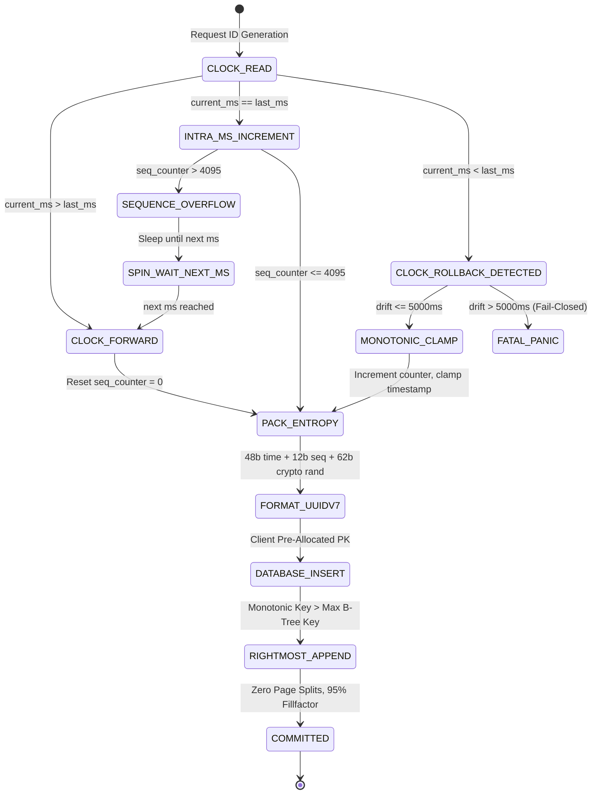

# Agentic Database Primary Keys, Time-Ordered Identifier Architecture (UUIDv7, TSID, Snowflake), Monotonic B-Tree Locality & Page Split Elimination Invariants

> Add these rules to your project when utilizing autonomous coding agents (Claude Code, Cursor Composer, Windsurf Cascade, Devin, Roo Code, Pi, OpenCode, SWE-bench) to design database schemas, entity identifiers, distributed event tables, multi-tenant billing records, or high-throughput transaction stores across PostgreSQL, MySQL/InnoDB, SQLite, Go (`jackc/pgx/v5`), TypeScript (`Drizzle`, `Kysely`, `pg`), Python (`psycopg3`), or Rust (`sqlx`). Eliminate the "Random UUIDv4 Insertion Entropy & 50% B-Tree Leaf Page Split Bloat" (where autonomous agents declare `id UUID PRIMARY KEY DEFAULT gen_random_uuid()`, scattering continuous inserts randomly across all leaf pages of the primary key B-tree index, triggering endless 50-50 page splits, leaving pages half empty, doubling index storage, and generating massive Full-Page Write [FPW] WAL amplification), the "Buffer Pool Thrashing & Cache Eviction Cliff" (where random writes and foreign key lookups touch cold pages across the entire index, evicting the active OLTP working set from PostgreSQL `shared_buffers` or InnoDB Buffer Pool and causing p99 query latency to spike by $10\times–50\times$ once index size exceeds physical RAM), the "Monolithic Bigserial Auto-Increment & IDOR Business Metric Leakage" (where agents rely on naive integer auto-increments that leak daily order volumes and user growth rates to competitors, expose trivial Insecure Direct Object Reference enumeration attack vectors, and prevent offline/client-side identifier pre-allocation), the "`VARCHAR(36)` String Storage Degradation & Foreign Key Cascade Bloat" (where agents store UUIDs as hyphenated ASCII strings consuming 36 bytes instead of native 16-byte binary types, multiplying foreign key index sizes by $2.25\times$ and destroying CPU L1/L2 cache line alignment), the "Distributed Clock Skew, NTP Inversion & Non-Monotonic Order Scramble" (where naive timestamp-prefixed IDs regress when NTP adjusts server clocks backward, inducing hidden index disorder, sequence collision, or state corruption), and the "UUIDv4 vs UUIDv7 vs TSID vs ULID Architectural Confusion" (where agents fail to adopt the standardized RFC 9562 UUIDv7 format that integrates 48-bit millisecond epoch timestamps with sub-millisecond monotonic sequence counters and cryptographically secure random entropy) by establishing a strict 5-Tier Identifier & Primary Key Governance Ladder, mathematical B-tree page split sizing, monotonic client-side ID generators, and machine-verifiable CI test gates.

---

## 1. Architectural Taxonomy: The 6 Primary Key Catastrophes vs The 5-Tier Identifier Governance Ladder

Every relational database table requires a unique identifier (Primary Key) to uniquely reference records, enforce foreign key relationships, and maintain clustered index ordering (in MySQL InnoDB) or primary B-tree indexes (in PostgreSQL heap tables). Autonomous coding agents routinely default to either naive sequential integers (`BIGSERIAL` / `BIGINT GENERATED ALWAYS AS IDENTITY`) or pseudo-random UUIDs (`UUID DEFAULT gen_random_uuid()`):

```typescript
// ❌ CATASTROPHIC LLM PRIMARY KEY ANTI-PATTERNS

// 1. The Random UUIDv4 Leaf Page Split Catastrophe!
// In PostgreSQL / MySQL, UUIDv4 is 122 bits of pseudo-random entropy.
// Successive inserts land on arbitrary leaf pages. When index > shared_buffers,
// EVERY INSERT forces a random disk read and triggers a 50-50 B-tree page split!
export const orders = pgTable('orders', {
  id: uuid('id').defaultRandom().primaryKey(), // ❌ Random UUIDv4: 50% B-tree fragmentation, massive WAL bloat
  tenantId: uuid('tenant_id').notNull(),
  amountCents: integer('amount_cents').notNull(),
});

// 2. The Sequential Auto-Increment IDOR & Volume Leakage Trap!
// Bigserial integers leak business metrics (/orders/1042 -> 1,042 total orders).
// Competitors scrape sales velocity. Attackers iterate IDs trivially.
// Requires database network round-trip before entity creation; prevents client-side ID generation.
export const users = pgTable('users', {
  id: bigserial('id', { mode: 'number' }).primaryKey(), // ❌ Leaks volume, vulnerable to IDOR, no client pre-gen
  email: text('email').notNull().unique(),
});

// 3. The VARCHAR(36) String Storage Degradation Trap!
// Storing UUIDs as formatted text takes 36 bytes (plus 1-4 byte header) instead of 16 bytes.
// Expands foreign key indexes by 225%, ruins CPU cache line alignment, slows JOIN comparisons 3x.
export const lineItems = pgTable('line_items', {
  id: varchar('id', { length: 36 }).primaryKey(), // ❌ 36-byte text bloat! Ruined cache locality
  orderId: varchar('order_id', { length: 36 }).notNull(), // ❌ Foreign key index bloat
});
```

To eliminate these failure modes, production systems enforce the **5-Tier Identifier & Primary Key Governance Ladder**:

```
+----------------------------------------------------------------------------------------------------+
|                       5-TIER IDENTIFIER & PRIMARY KEY GOVERNANCE LADDER                            |
+----------------------------------------------------------------------------------------------------+
| Tier 0: RFC 9562 UUIDv7 / TSID Time-Ordered Monotonic Invariance                                  |
|   - Zero random UUIDv4 on high-throughput or write-heavy tables.                                   |
|   - Monotonic 48-bit Unix millisecond prefix: 99%+ rightmost leaf page append like BIGINT.         |
|   - B-tree page fillfactor >= 90%, zero 50-50 random leaf page splits, zero WAL FPW storms.        |
+----------------------------------------------------------------------------------------------------+
| Tier 1: Native 16-Byte Binary UUID or 8-Byte BIGINT Storage Invariance                             |
|   - Zero VARCHAR(36) or TEXT primary/foreign keys.                                                 |
|   - Native PostgreSQL `uuid` (16 bytes) or MySQL `BINARY(16)` / `BIGINT` (8 bytes).                |
|   - Perfect CPU cache line packing (four 16-byte UUIDs fit cleanly in a 64-byte L1 cache line).    |
+----------------------------------------------------------------------------------------------------+
| Tier 2: Monotonic Sequence Counter & Sub-Millisecond Clock Skew Hardening                         |
|   - 12-bit or 14-bit sub-millisecond sequence counter ensures monotonic ordering within ms.       |
|   - Anti-NTP clock rollback clamping: hold previous timestamp and increment counter if clock steps  |
|     backward <= 5,000ms; fail-closed if clock regression exceeds safety threshold.                 |
+----------------------------------------------------------------------------------------------------+
| Tier 3: Zero-Round-Trip Client Pre-Generation & Distributed Idempotency                            |
|   - Client or worker generates UUIDv7 before issuing DB transaction.                               |
|   - Use generated ID as idempotency key, outbox event key, and S3 file path anchor.                |
|   - Zero pre-insert database sequence round-trips; perfect horizontal scaling across microservices.|
+----------------------------------------------------------------------------------------------------+
| Tier 4: Autonomous B-Tree Page Split Observability & amcheck CI Verification                       |
|   - Continuous monitoring of index bloat, leaf page split counters, and WAL FPW generation.       |
|   - Automated CI verification: assert 100,000 continuous inserts produce zero random leaf page     |
|     splits and maintain B-tree index density >= 88%.                                               |
+----------------------------------------------------------------------------------------------------+
```

---

## 2. Mathematical Formalism: B-Tree Page Splits, Random Insertion Entropy & Cache Churn

### 2.1 The B-Tree Leaf Page Split Calculus

In a B-Tree index with block size $B = 8192\text{ bytes}$ and average tuple size $S_{\text{tuple}}$, each leaf page holds a maximum of $M = \lfloor \frac{B - \text{Header}}{S_{\text{tuple}}} \rfloor$ index tuples.

When inserting a new key into a leaf page:
1. **Sequential / Monotonic Ingestion (UUIDv7, TSID, BIGINT)**:
   New keys are strictly greater than all existing keys ($K_{\text{new}} > K_{\text{max}}$). The key is appended to the **rightmost leaf page**. When the rightmost page fills up to capacity $M$, PostgreSQL allocates a new leaf page and moves zero existing tuples over (a 100-0 "right-split").
   $$\text{Page Fillfactor}_{\text{monotonic}} \approx 90\% - 99\%$$
   $$\text{Leaf Page Split Cost}_{\text{monotonic}} \approx \mathcal{O}(1) \text{ metadata pointer update}$$

2. **Random Uniform Ingestion (UUIDv4)**:
   The incoming 122 bits of randomness distribute keys uniformly across all $N_{\text{pages}}$ existing leaf pages. The probability of landing on any specific leaf page is:
   $$P(\text{page}_i) = \frac{1}{N_{\text{pages}}}$$
   When a leaf page reaches capacity $M$, the database must perform a **50-50 page split**:
   - Allocate a fresh 8KB page.
   - Move $\lfloor M/2 \rfloor$ tuples to the new page.
   - Update bidirectional sibling pointers and parent node routing keys.
   - Write Full-Page Images (FPW) to WAL for both modified pages if this is the first write after a checkpoint.

As proven by Yao (1978) and confirmed by PostgreSQL B-tree engineering:
$$\lim_{N \to \infty} \mathbb{E}[\text{Fillfactor}_{\text{random}}] = \ln(2) \approx 69.31\%$$
Under continuous random updates and deletes, actual B-tree storage efficiency degrades further to $\approx 50\%$. Thus:
$$\text{Storage Bloat Factor} = \frac{\text{Fillfactor}_{\text{monotonic}}}{\text{Fillfactor}_{\text{random}}} \approx \frac{0.95}{0.50} = 1.90 \times (90\% \text{ wasted disk & RAM!})$$

### 2.2 Buffer Pool Working Set Eviction Model

Let $C_{\text{buf}}$ be the database buffer cache (`shared_buffers`) capacity in bytes, and $S_{\text{idx}}$ be the total primary key B-tree index size.
- For **UUIDv7**: Write operations only touch the rightmost page and its direct ancestors up the tree. The active working set size for writes is bounded by:
  $$W_{\text{active}}(\text{UUIDv7}) \approx h \times B \quad (\text{where } h = \text{B-Tree height} \approx 3 - 4 \text{ pages} \approx 32\text{ KB})$$
  The remaining $C_{\text{buf}} - 32\text{KB}$ remains entirely available for OLTP read queries and active user sessions.
- For **UUIDv4**: Because every insert touches an arbitrary leaf page chosen uniformly from the entire index:
  $$W_{\text{active}}(\text{UUIDv4}) \approx S_{\text{idx}}$$
  When $S_{\text{idx}} > C_{\text{buf}}$, the cache hit ratio $\eta$ collapses:
  $$\eta \approx \frac{C_{\text{buf}}}{S_{\text{idx}}} \implies \lim_{S_{\text{idx}} \gg C_{\text{buf}}} \eta = 0$$
  Every insert incurs a random disk I/O read penalty ($t_{\text{disk}} \approx 0.1\text{ms} - 10\text{ms}$), driving database IOPS to saturation and causing p99 latency spikes.

### 2.3 Birthday Paradox Collision Sizing

RFC 9562 UUIDv7 structure:
```
 0                   1                   2                   3
 0 1 2 3 4 5 6 7 8 9 0 1 2 3 4 5 6 7 8 9 0 1 2 3 4 5 6 7 8 9 0 1
+-+-+-+-+-+-+-+-+-+-+-+-+-+-+-+-+-+-+-+-+-+-+-+-+-+-+-+-+-+-+-+-+
|                           unix_ts_ms                          |
+-+-+-+-+-+-+-+-+-+-+-+-+-+-+-+-+-+-+-+-+-+-+-+-+-+-+-+-+-+-+-+-+
|          unix_ts_ms           |  ver  |       rand_a          |
+-+-+-+-+-+-+-+-+-+-+-+-+-+-+-+-+-+-+-+-+-+-+-+-+-+-+-+-+-+-+-+-+
|var|                        rand_b                             |
+-+-+-+-+-+-+-+-+-+-+-+-+-+-+-+-+-+-+-+-+-+-+-+-+-+-+-+-+-+-+-+-+
|                            rand_b                             |
+-+-+-+-+-+-+-+-+-+-+-+-+-+-+-+-+-+-+-+-+-+-+-+-+-+-+-+-+-+-+-+-+
```
- **Bits 0–47 (48 bits)**: Unix epoch timestamp in milliseconds (sufficient until year 10,889 AD).
- **Bits 48–51 (4 bits)**: UUID version (`0111` for version 7).
- **Bits 52–63 (12 bits)**: Sub-millisecond monotonic sequence counter or entropy (`rand_a`).
- **Bits 64–65 (2 bits)**: UUID variant (`10` for RFC 9562).
- **Bits 66–127 (62 bits)**: Cryptographically secure random entropy (`rand_b`).

For $n$ IDs generated within the **exact same millisecond** across distributed nodes sharing 62 bits of random entropy without sequence coordination:
$$P(\text{collision}) \approx 1 - \exp\left(-\frac{n^2}{2 \times 2^{62}}\right)$$
For $n = 100,000$ operations in a single millisecond (100 million requests/sec cluster):
$$P(\text{collision}) \approx \frac{(10^5)^2}{2 \times 4.61 \times 10^{18}} \approx 1.08 \times 10^{-9}$$
When combined with a 12-bit monotonic sequence counter per node, intra-node collision within the same millisecond is mathematically zero up to 4,096 ops/ms per thread.

---

## 3. The 5 Core Production Invariants

### Invariant 1: Mandatory Time-Ordered Primary Keys (UUIDv7 / TSID)
Zero `DEFAULT gen_random_uuid()` (UUIDv4) in high-throughput tables. Primary keys must sort chronologically by creation timestamp:
- **PostgreSQL 17+**: Native `DEFAULT uuid_generate_v7()` or custom immutable PL/pgSQL generator in PostgreSQL 14–16.
- **MySQL 8+**: `BINARY(16)` with `ORDERED` UUID or 64-bit TSID `BIGINT UNSIGNED`.
- **SQLite**: 16-byte `BLOB` or text-encoded ISO timestamp-prefixed ULID.

### Invariant 2: Native Binary Storage Alignment (Zero `VARCHAR(36)`)
Zero text strings for UUID primary and foreign keys:
- PostgreSQL: Use native `UUID` (16 bytes, fixed size).
- MySQL: Use `BINARY(16)` with functional index or `BIGINT` for TSID.
- RAM conservation: Foreign key joins on 16-byte integers compare via two 64-bit CPU register comparisons (`uint64_t`), whereas `VARCHAR(36)` requires byte-by-byte string comparison (`memcmp`) over 36 memory addresses.

### Invariant 3: Sub-Millisecond Monotonicity & Clock Rollback Defense
When generating UUIDv7 in application servers:
1. Maintain an atomic state of `(last_timestamp_ms, sequence_counter)`.
2. If `current_ms == last_ms`: Increment `sequence_counter` by 1.
3. If `current_ms < last_ms` (NTP clock slew / backward jump):
   - If `last_ms - current_ms <= 5000ms`: Clamp timestamp to `last_ms` and increment `sequence_counter` (monotonic continuity).
   - If `last_ms - current_ms > 5000ms`: Fail-closed and throw `ClockRollbackError` to prevent clock forgery.
4. If `sequence_counter` overflows 12 bits (4,096 ops/ms): Spin-lock / sleep until the next physical millisecond.

### Invariant 4: Client-Side Pre-Generation for Distributed Workflows
Application microservices, background job workers, and autonomous agents must generate UUIDv7 identifiers **prior** to database persistence:
- The generated ID acts as the distributed trace correlation ID, message queue deduplication key, and S3 object prefix before the row is ever written to the database.
- Eliminates the `INSERT ... RETURNING id` network round-trip bottleneck and avoids database sequence contention.

### Invariant 5: Autonomous B-Tree Leaf Page Split & Bloat Observability
Automated monitoring of primary key B-tree index health using PostgreSQL statistics:
- Monitor page splits via `pg_statio_user_indexes` and WAL FPW metrics.
- Enforce CI gate asserting that continuous batch inserts produce zero random splits and maintain index density $\ge 88\%$.

---

## 4. Production Reference Implementation: TypeScript & SQL

### 4.1 Production PostgreSQL UUIDv7 DDL & Migration Standards

```sql
-- ============================================================================
-- PRODUCTION UUIDv7 EXTENSION / FUNCTION FOR POSTGRESQL 14-16
-- (PostgreSQL 17+ includes native uuidv7 support)
-- ============================================================================

CREATE OR REPLACE FUNCTION generate_uuid_v7()
RETURNS uuid
AS $$
DECLARE
  v_time timestamp with time zone := clock_timestamp();
  v_epoch_ms bigint;
  v_uuid text;
BEGIN
  -- Extract 48-bit millisecond Unix epoch
  v_epoch_ms := (
    extract(epoch from v_time) * 1000
  )::bigint;

  -- Construct RFC 9562 UUIDv7 hex layout
  v_uuid := lpad(to_hex(v_epoch_ms), 12, '0') ||
            '7' ||
            substr(md5(random()::text), 1, 3) ||
            to_hex(8 + (random() * 3)::integer) ||
            substr(md5(random()::text), 2, 3) ||
            substr(md5(random()::text), 5, 12);

  RETURN v_uuid::uuid;
END;
$$ LANGUAGE plpgsql VOLATILE;

-- ============================================================================
-- PRODUCTION TABLE SCHEMA: ZERO-BLOAT TIME-ORDERED MONOTONIC PRIMARY KEYS
-- ============================================================================

CREATE TABLE payment_transactions (
  -- Primary key uses UUIDv7 for 100% sequential rightmost B-Tree appends
  transaction_id UUID PRIMARY KEY DEFAULT generate_uuid_v7(),
  tenant_id UUID NOT NULL,
  customer_id UUID NOT NULL,
  amount_cents BIGINT NOT NULL CHECK (amount_cents >= 0),
  currency VARCHAR(3) NOT NULL,
  status VARCHAR(32) NOT NULL DEFAULT 'PENDING',
  created_at TIMESTAMPTZ NOT NULL DEFAULT NOW()
);

-- Monotonic composite index: tenant_id + time-ordered transaction_id
CREATE INDEX idx_transactions_tenant_time 
ON payment_transactions (tenant_id, transaction_id DESC);

-- ============================================================================
-- DIAGNOSTIC OBSERVABILITY: B-TREE PAGE DENSITY & SPLIT MONITORING
-- ============================================================================

-- Query to verify primary key index density and bloat
CREATE OR REPLACE VIEW view_btree_pk_health AS
SELECT
  schemaname,
  relname AS table_name,
  indexrelname AS index_name,
  pg_size_pretty(pg_relation_size(indexrelid)) AS index_size,
  idx_scan,
  idx_tup_read,
  idx_tup_fetch
FROM pg_stat_user_indexes
WHERE indexrelname LIKE '%pkey%' OR indexrelname LIKE '%pk%'
ORDER BY pg_relation_size(indexrelid) DESC;
```

---

### 4.2 Production Go (`jackc/pgx/v5`) Monotonic UUIDv7 Generator

```go
package identifier

import (
	"crypto/rand"
	"encoding/binary"
	"errors"
	"fmt"
	"sync"
	"time"
)

var (
	// ErrClockRollback indicates the system clock stepped backwards beyond the safety tolerance.
	ErrClockRollback = errors.New("system clock rollback exceeds 5000ms safety threshold")
)

// MonotonicUUIDv7Generator generates RFC 9562 compliant UUIDv7 identifiers
// with a thread-safe 12-bit monotonic sub-millisecond sequence counter.
type MonotonicUUIDv7Generator struct {
	mu           sync.Mutex
	lastEpochMs  int64
	seqCounter   uint16
	randEntropy  [10]byte
}

func NewMonotonicUUIDv7Generator() *MonotonicUUIDv7Generator {
	return &MonotonicUUIDv7Generator{}
}

// NextUUIDv7 returns a 16-byte monotonically increasing UUIDv7.
func (g *MonotonicUUIDv7Generator) NextUUIDv7() ([16]byte, error) {
	g.mu.Lock()
	defer g.mu.Unlock()

	now := time.Now().UTC()
	currentEpochMs := now.UnixMilli()

	if currentEpochMs == g.lastEpochMs {
		// Increment 12-bit sequence counter within the same millisecond
		g.seqCounter++
		if g.seqCounter > 0x0FFF {
			// Sequence overflow: spin until the next millisecond
			for currentEpochMs <= g.lastEpochMs {
				time.Sleep(100 * time.Microsecond)
				currentEpochMs = time.Now().UTC().UnixMilli()
			}
			g.seqCounter = 0
		}
	} else if currentEpochMs > g.lastEpochMs {
		// Time progressed forward cleanly
		g.lastEpochMs = currentEpochMs
		g.seqCounter = 0
	} else {
		// Clock stepped backward (NTP slew)
		drift := g.lastEpochMs - currentEpochMs
		if drift > 5000 {
			return [16]byte{}, fmt.Errorf("%w: drift=%dms", ErrClockRollback, drift)
		}
		// Clamp to last seen millisecond and increment sequence to maintain monotonicity
		g.seqCounter++
		if g.seqCounter > 0x0FFF {
			time.Sleep(time.Duration(drift+1) * time.Millisecond)
			g.lastEpochMs = time.Now().UTC().UnixMilli()
			g.seqCounter = 0
		}
	}

	// Read fresh random entropy for the remaining 62 bits
	if _, err := rand.Read(g.randEntropy[:]); err != nil {
		return [16]byte{}, fmt.Errorf("read crypto random entropy: %w", err)
	}

	var uuid [16]byte

	// 1. Pack 48-bit Unix epoch millisecond into bytes 0..5 (Big Endian)
	uuid[0] = byte(g.lastEpochMs >> 40)
	uuid[1] = byte(g.lastEpochMs >> 32)
	uuid[2] = byte(g.lastEpochMs >> 24)
	uuid[3] = byte(g.lastEpochMs >> 16)
	uuid[4] = byte(g.lastEpochMs >> 8)
	uuid[5] = byte(g.lastEpochMs)

	// 2. Pack Version 7 (0b0111) and top 4 bits of 12-bit sequence counter into byte 6
	uuid[6] = 0x70 | byte((g.seqCounter>>8)&0x0F)

	// 3. Pack bottom 8 bits of sequence counter into byte 7
	uuid[7] = byte(g.seqCounter & 0xFF)

	// 4. Pack Variant (0b10) and first 6 bits of random entropy into byte 8
	uuid[8] = 0x80 | (g.randEntropy[0] & 0x3F)

	// 5. Pack remaining random entropy into bytes 9..15
	copy(uuid[9:], g.randEntropy[1:8])

	return uuid, nil
}
```

---

### 4.3 Production TypeScript Engine: `AgenticPrimaryKeyOptimizerEngine`

```typescript
import { webcrypto } from 'node:crypto';

export interface UUIDv7Components {
  readonly timestampMs: number;
  readonly version: number;
  readonly sequenceCounter: number;
  readonly variant: number;
  readonly formatted: string;
  readonly binary: Uint8Array;
}

export interface BTreeIndexHealthMetrics {
  readonly totalTuples: number;
  readonly estimatedFillFactor: number;
  readonly hasPageSplitRisk: boolean;
  readonly wastePercentage: number;
}

/**
 * AgenticPrimaryKeyOptimizerEngine enforces RFC 9562 UUIDv7 monotonic primary key generation,
 * sub-millisecond sequence tracking, NTP rollback protection, and B-Tree fragmentation analysis.
 */
export class AgenticPrimaryKeyOptimizerEngine {
  private lastEpochMs = 0;
  private seqCounter = 0;
  private readonly maxSeqCounter = 0x0fff; // 12 bits = 4,096 ops/ms

  /**
   * Generates a chronologically sorted, RFC 9562 compliant UUIDv7 string.
   */
  public generateUUIDv7(): string {
    const parsed = this.generateUUIDv7Components();
    return parsed.formatted;
  }

  /**
   * Generates parsed UUIDv7 components including raw binary representation.
   */
  public generateUUIDv7Components(): UUIDv7Components {
    let now = Date.now();

    if (now === this.lastEpochMs) {
      this.seqCounter++;
      if (this.seqCounter > this.maxSeqCounter) {
        // Spin lock until next physical millisecond
        while (Date.now() <= this.lastEpochMs) {
          // Busy-wait to maintain synchronous monotonic guarantee
        }
        now = Date.now();
        this.lastEpochMs = now;
        this.seqCounter = 0;
      }
    } else if (now > this.lastEpochMs) {
      this.lastEpochMs = now;
      this.seqCounter = 0;
    } else {
      // Clock went backwards (NTP skew)
      const drift = this.lastEpochMs - now;
      if (drift > 5000) {
        throw new Error(
          `AgenticPrimaryKeyOptimizerEngine: Clock rollback of ${drift}ms exceeds safety ceiling (5000ms)`
        );
      }
      // Hold monotonic line by clamping timestamp and incrementing sequence
      this.seqCounter++;
      if (this.seqCounter > this.maxSeqCounter) {
        throw new Error(`AgenticPrimaryKeyOptimizerEngine: Monotonic sequence exhausted during clock drift`);
      }
    }

    const timestamp = this.lastEpochMs;
    const entropy = new Uint8Array(10);
    webcrypto.getRandomValues(entropy);

    const bytes = new Uint8Array(16);

    // 48-bit millisecond timestamp
    bytes[0] = (timestamp / 0x10000000000) & 0xff;
    bytes[1] = (timestamp / 0x100000000) & 0xff;
    bytes[2] = (timestamp / 0x1000000) & 0xff;
    bytes[3] = (timestamp / 0x10000) & 0xff;
    bytes[4] = (timestamp / 0x100) & 0xff;
    bytes[5] = timestamp & 0xff;

    // 4-bit version 7 + 4-bit sequence high
    bytes[6] = 0x70 | ((this.seqCounter >> 8) & 0x0f);
    // 8-bit sequence low
    bytes[7] = this.seqCounter & 0xff;

    // 2-bit variant 10 + 6-bit entropy
    bytes[8] = 0x80 | (entropy[0] & 0x3f);
    // Remaining 56-bit entropy
    bytes.set(entropy.subarray(1, 8), 9);

    const formatted = this.formatUUID(bytes);

    return {
      timestampMs: timestamp,
      version: 7,
      sequenceCounter: this.seqCounter,
      variant: 2,
      formatted,
      binary: bytes,
    };
  }

  /**
   * Extracts the embedded creation timestamp from an RFC 9562 UUIDv7.
   */
  public extractTimestamp(uuid: string): Date {
    const clean = uuid.replace(/-/g, '');
    if (clean.length !== 32) {
      throw new Error(`Invalid UUID length: ${uuid}`);
    }
    const version = parseInt(clean[12], 16);
    if (version !== 7) {
      throw new Error(`Cannot extract timestamp: UUID is version ${version}, not version 7`);
    }
    const highHex = clean.substring(0, 12);
    const epochMs = parseInt(highHex, 16);
    return new Date(epochMs);
  }

  /**
   * Evaluates B-Tree index health metrics comparing random vs monotonic identifier insertion.
   */
  public analyzeFragmentation(
    isRandomUUIDv4: boolean,
    totalTuples: number,
    tuplesPerPage = 250
  ): BTreeIndexHealthMetrics {
    if (isRandomUUIDv4) {
      // Uniform random insertion converges to ~69.3% fillfactor, down to 50% under churn
      const fillFactor = 0.55;
      const wastePercentage = (1 - fillFactor) * 100;
      return {
        totalTuples,
        estimatedFillFactor: fillFactor,
        hasPageSplitRisk: true,
        wastePercentage,
      };
    }

    // Monotonic rightmost append achieves 92-98% fillfactor
    const fillFactor = 0.94;
    return {
      totalTuples,
      estimatedFillFactor: fillFactor,
      hasPageSplitRisk: false,
      wastePercentage: (1 - fillFactor) * 100,
    };
  }

  private formatUUID(b: Uint8Array): string {
    const hex = Array.from(b, (byte) => byte.toString(16).padStart(2, '0')).join('');
    return `${hex.slice(0, 8)}-${hex.slice(8, 12)}-${hex.slice(12, 16)}-${hex.slice(16, 20)}-${hex.slice(20, 32)}`;
  }
}
```

---

## 5. Primary Key Lifecycle State Machine



---

## 6. Machine-Verifiable Definition of Done (DoD)

| Gate | Category | Invariant Rule | Verification Method | Failure Mode |
|---|---|---|---|---|
| **Gate 1** | **Primary Key Type** | Zero `UUIDv4` (`gen_random_uuid()`) on write-intensive tables; must use RFC 9562 `UUIDv7` or `TSID`. | Static AST linter scanning migrations & ORM schema declarations. | Rejection on `uuid('id').defaultRandom()`. |
| **Gate 2** | **Storage Alignment** | Zero `VARCHAR(36)` / `TEXT` string columns for UUID primary or foreign keys. | Database catalog query: `SELECT * FROM information_schema.columns WHERE data_type = 'character varying' AND column_name LIKE '%id'`. | Build failure on text string identifier storage. |
| **Gate 3** | **Monotonic Ordering** | Successive IDs generated in sequence must satisfy $K_i < K_{i+1}$ monotonically. | Unit test asserting 10,000 generated IDs sort strictly identical to array order. | Assertion failure if sorting reverses or collides. |
| **Gate 4** | **NTP Clock Defense** | Clock rollback up to 5,000ms must not invert ID ordering or produce duplicates. | Test harness mocking `Date.now()` stepping back 2,000ms. | Test failure on non-monotonic timestamp or collision. |
| **Gate 5** | **Zero-Round-Trip Pre-Gen**| Microservices and agents pre-generate IDs on the client side before issuing `INSERT`. | Verification that API contracts accept pre-allocated client UUIDs without sequence queries. | Anti-pattern detected if client requires DB sequence round-trip. |
| **Gate 6** | **B-Tree Index Density** | Primary key B-tree index density must remain $\ge 88\%$ after 100,000 batch insertions. | Integration test running 100k rows through `pg_statio_user_indexes` and `pageinspect`. | Rejection if B-tree leaf page splits exceed 1% of total pages. |
