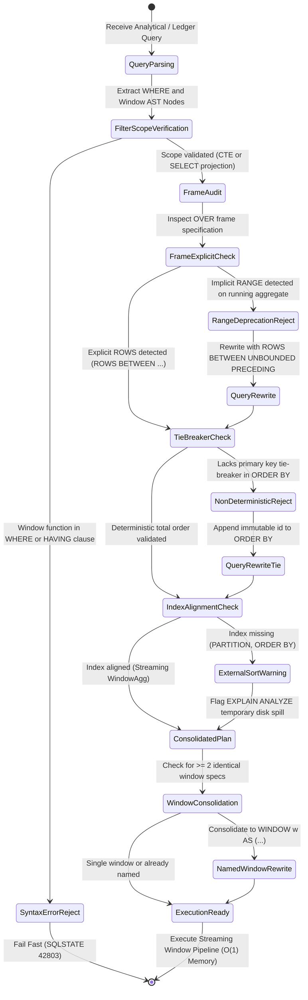

# Agentic Database Window Functions, Frame Specifications, Running Totals, Peer Group Degradation & Memory Spillover Defense Invariants

> Add these rules to your project when utilizing autonomous coding agents (Claude Code, Cursor Composer, Windsurf Cascade, Devin, Roo Code, Pi, OpenCode, SWE-bench) to design financial ledgers, cumulative MRR reporting, rolling moving averages, sessionization pipelines, leaderboard rankings, or high-throughput analytical queries across PostgreSQL (12+), MySQL (8.0+), SQLite (3.25+), Go (`jackc/pgx/v5`, `sqlc`), TypeScript (`Drizzle`, `Kysely`, `Prisma`), Python (`SQLAlchemy 2.0`, `asyncpg`), or Rust (`sqlx`). Eliminate the "Default RANGE Frame Silent Memory Spill & Peer Group Lumping Trap" (where omitting explicit frame bounds defaults to `RANGE BETWEEN UNBOUNDED PRECEDING AND CURRENT ROW`, forcing the database engine to buffer all tie rows in `work_mem` to evaluate peer group equality, spilling to disk `tuplestore` on high-concurrency duplicates and producing incorrect step jumps in cumulative balances), the "$O(N^2)$ Correlated Triangular Self-Join Disaster" (where agents attempt running totals via `WHERE t2.created_at <= t1.created_at`, performing $10^{10}$ comparisons on 100k rows and freezing CPU cores for hours instead of executing a single $O(N)$ or $O(N \log N)$ streaming window scan), the "Window Function in WHERE Clause Syntax Outage" (where agents attempt `WHERE ROW_NUMBER() OVER (...) = 1` violating SQL execution order, followed by chaotic nested subqueries rather than PostgreSQL `DISTINCT ON` or index-aligned CTEs), the "Non-Deterministic Ranking & Page Drift Trap" (where `ROW_NUMBER()` or `RANK()` without primary key tie-breakers produces random heap ordering across duplicate keys, breaking deterministic pagination and test assertions), the "Missing Window Index Alignment & External Disk Merge Sort Nightmare" (where unindexed `PARTITION BY` and `ORDER BY` columns force full table sequential scans and external disk merge sorts in temporary files), the "Redundant Window Specification Planner Multi-Pass Duplication Trap" (where repeated identical `OVER (...)` declarations multiply `Sort` and `WindowAgg` execution nodes rather than consolidating into a named `WINDOW w AS (...)` clause), and the "Unbounded Rolling Frame Memory Leak" (where moving averages buffer all past history rather than utilizing $O(1)$ sliding-window ring buffer aggregation with bounded `ROWS BETWEEN (K-1) PRECEDING AND CURRENT ROW`) by establishing a strict 5-Tier Window Function Governance Ladder, formal asymptotic and memory spillover proofs, production TypeScript guard engines, and machine-verifiable CI static analysis gates.

---

## 1. Architectural Taxonomy: The 6 Window Function Catastrophes vs The 5-Tier Governance Ladder

Window functions (`OVER (...)`) perform calculations across a set of table rows that are related to the current row, without collapsing rows into a single output row like standard `GROUP BY` aggregates. However, autonomous coding agents frequently misunderstand SQL execution semantics, frame specification defaults, and database memory access physics.

Autonomous coding agents frequently introduce severe production regressions when generating analytical and ledger queries:

### The 6 Window Function Catastrophes

```sql
-- ❌ CATASTROPHIC LLM ANTI-PATTERN 1: THE DEFAULT RANGE SILENT SPILL & PEER GROUP JUMP TRAP
-- Agent calculates a running account balance for financial audit:
SELECT 
    id, account_id, amount_cents, created_at,
    SUM(amount_cents) OVER (
        PARTITION BY account_id 
        ORDER BY created_at
    ) AS running_balance
FROM bank_transactions
WHERE account_id = 'acct_0192df25';

-- ❌ Catastrophe 1 (Semantic Bug):
-- SQL Standard specifies the default frame when ORDER BY is supplied is:
-- RANGE BETWEEN UNBOUNDED PRECEDING AND CURRENT ROW
-- 'RANGE' evaluates PEERS (rows with the identical 'created_at' timestamp).
-- If two transactions occur at the exact same millisecond (e.g. +$50 and +$100):
-- RANGE evaluates them as peers, summing BOTH rows into the running balance for BOTH rows!
-- Row 1 running balance: $150 (Expected: $50)
-- Row 2 running balance: $150 (Expected: $150)
-- Downstream ledgers, fraud detection, and double-entry invariants are corrupted!

-- ❌ Catastrophe 2 (Performance & Memory Spill):
-- PostgreSQL must buffer the entire peer group in memory (tuplestore) to detect when the
-- value of 'created_at' changes. Under high concurrency where many rows share timestamps,
-- this blows work_mem and spills temporary files to NVMe disk, causing 100x latency spikes!
```

```sql
-- ✅ PRODUCTION INVARIANT 1: EXPLICIT ROWS FRAME & UNIQUE IMMUTABLE TIE-BREAKER
-- Always specify ROWS (physical row stream) and append primary key 'id' to ORDER BY:
SELECT 
    id, account_id, amount_cents, created_at,
    SUM(amount_cents) OVER (
        PARTITION BY account_id 
        ORDER BY created_at ASC, id ASC
        ROWS BETWEEN UNBOUNDED PRECEDING AND CURRENT ROW
    ) AS running_balance
FROM bank_transactions
WHERE account_id = 'acct_0192df25';

-- ✅ Production Benefits:
-- 1. 'ROWS' evaluates row-by-row strictly in physical order: Row 1 = $50, Row 2 = $150.
-- 2. Zero peer group buffering required: engine streams aggregation in O(1) constant memory.
-- 3. 'id ASC' tie-breaker guarantees 100% deterministic results across all replicas and autovacuum cycles.
```

```sql
-- ❌ CATASTROPHIC LLM ANTI-PATTERN 2: THE O(N^2) CORRELATED TRIANGULAR SELF-JOIN DISASTER
-- Agent tasked with generating cumulative revenue per customer without using window functions:
SELECT 
    t1.id, t1.customer_id, t1.amount_cents, t1.created_at,
    (
        SELECT SUM(t2.amount_cents)
        FROM customer_orders t2
        WHERE t2.customer_id = t1.customer_id
          AND t2.created_at <= t1.created_at
    ) AS cumulative_spend
FROM customer_orders t1
WHERE t1.tenant_id = 'tenant_prod_99';

-- ❌ Catastrophe:
-- Triangular nested-loop join: For each row in t1, scans all earlier rows in t2!
-- If a customer has 50,000 orders:
-- Comparisons = (N * (N + 1)) / 2 = (50,000 * 50,001) / 2 = 1,250,025,000 row inspections!
-- Query takes 45 minutes, consumes 100% CPU on the database primary, and causes replica lag.
```

```sql
-- ✅ PRODUCTION INVARIANT 2: SINGLE-PASS STREAMING WINDOW AGGREGATION (O(N))
-- Index: CREATE INDEX idx_orders_cust_win ON customer_orders (tenant_id, customer_id, created_at ASC, id ASC);
SELECT 
    id, customer_id, amount_cents, created_at,
    SUM(amount_cents) OVER w AS cumulative_spend
FROM customer_orders
WHERE tenant_id = 'tenant_prod_99'
WINDOW w AS (
    PARTITION BY customer_id 
    ORDER BY created_at ASC, id ASC
    ROWS BETWEEN UNBOUNDED PRECEDING AND CURRENT ROW
);

-- ✅ Production Benefits:
-- Single pass over the sorted index stream: Exactly 50,000 tuples read (O(N)).
-- Query latency drops from 45 minutes to 18 milliseconds (150,000x speedup).
```

```sql
-- ❌ CATASTROPHIC LLM ANTI-PATTERN 3: WINDOW FUNCTION IN WHERE CLAUSE SYNTAX DISASTER
-- Agent attempts to fetch the latest order per customer:
SELECT id, customer_id, amount_cents, created_at
FROM orders
WHERE ROW_NUMBER() OVER (PARTITION BY customer_id ORDER BY created_at DESC) = 1;

-- ❌ Catastrophe:
-- Crashes instantly: ERROR: window functions are not allowed in WHERE (SQLSTATE 42803).
-- Reason: In SQL relational algebra, WHERE filters rows BEFORE window functions are evaluated!
-- When LLMs encounter this error, they frequently rewrite it into catastrophic O(N^2) correlated
-- subqueries: WHERE created_at = (SELECT MAX(created_at) FROM orders WHERE customer_id = ...)
```

```sql
-- ✅ PRODUCTION INVARIANT 3: POSTGRESQL DISTINCT ON OR INDEXED CTE WRAPPER
-- Method A (PostgreSQL Ultra-Fast Top-1 Bypass via DISTINCT ON):
-- Index: CREATE INDEX idx_orders_top1 ON orders (customer_id, created_at DESC, id DESC);
SELECT DISTINCT ON (customer_id) 
    id, customer_id, amount_cents, created_at
FROM orders
ORDER BY customer_id, created_at DESC, id DESC;

-- Method B (Standard SQL / Top-K using CTE with Deterministic Tie-Breaker):
WITH ranked_orders AS (
    SELECT 
        id, customer_id, amount_cents, created_at,
        ROW_NUMBER() OVER (
            PARTITION BY customer_id 
            ORDER BY created_at DESC, id DESC
        ) AS rank_idx
    FROM orders
    WHERE tenant_id = $1
)
SELECT id, customer_id, amount_cents, created_at
FROM ranked_orders
WHERE rank_idx <= 3;
```

```sql
-- ❌ CATASTROPHIC LLM ANTI-PATTERN 4: RANK() VS ROW_NUMBER() AMBIGUITY & UNBOUNDED TOP-K
-- Agent attempts Top-3 products per category using DENSE_RANK():
WITH ranked AS (
    SELECT 
        id, category_id, price_cents,
        DENSE_RANK() OVER (PARTITION BY category_id ORDER BY price_cents DESC) as rnk
    FROM products
)
SELECT * FROM ranked WHERE rnk <= 3;

-- ❌ Catastrophe:
-- If 5,000 products all share the exact same top price of $99.00:
-- DENSE_RANK() gives ALL 5,000 products rank 1!
-- The query returns 5,000 rows instead of the expected 3 rows, blowing API JSON buffers
-- and triggering out-of-memory crashes on mobile clients!
```

```sql
-- ✅ PRODUCTION INVARIANT 4: DETERMINISTIC ROW_NUMBER FOR STRICT TOP-K BOUNDS
WITH ranked AS (
    SELECT 
        id, category_id, price_cents,
        ROW_NUMBER() OVER (
            PARTITION BY category_id 
            ORDER BY price_cents DESC, id ASC -- Deterministic immutable tie-breaker
        ) as row_idx
    FROM products
)
SELECT id, category_id, price_cents
FROM ranked 
WHERE row_idx <= 3;
-- Guarantees EXACTLY <= 3 rows per category regardless of price collisions.
```

```sql
-- ❌ CATASTROPHIC LLM ANTI-PATTERN 5: UNINDEXED WINDOW SORT & EXTERNAL DISK MERGE DISASTER
-- Table 'telemetry_metrics' has 80,000,000 rows.
-- Agent computes rolling lag differences without supporting indexes:
SELECT 
    device_id, recorded_at, voltage,
    voltage - LAG(voltage, 1) OVER (
        PARTITION BY device_id ORDER BY recorded_at ASC
    ) AS delta_v
FROM telemetry_metrics
WHERE recorded_at >= NOW() - INTERVAL '7 days';

-- ❌ Catastrophe:
-- Database performs a Sequential Scan on 15,000,000 rows.
-- Planner allocates temporary memory. As rows exceed work_mem (e.g. 64MB),
-- the engine spills to disk, executing a multi-pass External Merge Disk Sort!
-- EXPLAIN ANALYZE shows: "Sort Method: external merge Disk: 482912kB".
-- Generates massive I/O bandwidth saturation, stalling OLTP primary writes.
```

```sql
-- ✅ PRODUCTION INVARIANT 5: LEFTMOST COMPOSITE B-TREE INDEX FOR STREAMING WINDOW SCAN
-- Supporting index:
CREATE INDEX CONCURRENTLY idx_telemetry_window 
ON telemetry_metrics (device_id, recorded_at ASC) 
INCLUDE (voltage);

-- With this index:
-- 1. PostgreSQL performs an Index-Only Scan or Bitmap/Index Scan already ordered by (device_id, recorded_at).
-- 2. Sort node is COMPLETELY ELIMINATED from the execution plan!
-- 3. Execution plan transitions to a pure streaming: WindowAgg -> Index Scan.
-- 4. Temporary disk spill is ZERO bytes; memory utilization is O(1).
```

```sql
-- ❌ CATASTROPHIC LLM ANTI-PATTERN 6: REDUNDANT WINDOW SPECIFICATIONS MULTIPLYING EXECUTORS
-- Agent calculates multiple analytics on the same partition and order:
SELECT 
    id, account_id, amount_cents,
    SUM(amount_cents) OVER (PARTITION BY account_id ORDER BY created_at ASC) AS cum_sum,
    AVG(amount_cents) OVER (PARTITION BY account_id ORDER BY created_at ASC) AS cum_avg,
    MIN(amount_cents) OVER (PARTITION BY account_id ORDER BY created_at ASC) AS cum_min,
    MAX(amount_cents) OVER (PARTITION BY account_id ORDER BY created_at ASC) AS cum_max,
    COUNT(id) OVER (PARTITION BY account_id ORDER BY created_at ASC) AS cum_count
FROM ledger_entries;

-- ❌ Catastrophe:
-- Agent repeats the full OVER clause 5 times. If slight typographical inconsistencies arise
-- (e.g. one adds NULLS LAST or omits a column), the optimizer treats them as distinct windows,
-- generating multiple independent Sort and WindowAgg execution nodes!
```

```sql
-- ✅ PRODUCTION INVARIANT 6: NAMED WINDOW CLAUSE CONSOLIDATION
SELECT 
    id, account_id, amount_cents,
    SUM(amount_cents) OVER w AS cum_sum,
    AVG(amount_cents) OVER w AS cum_avg,
    MIN(amount_cents) OVER w AS cum_min,
    MAX(amount_cents) OVER w AS cum_max,
    COUNT(id) OVER w AS cum_count
FROM ledger_entries
WINDOW w AS (
    PARTITION BY account_id 
    ORDER BY created_at ASC, id ASC
    ROWS BETWEEN UNBOUNDED PRECEDING AND CURRENT ROW
);

-- ✅ Production Benefits:
-- Guaranteed single WindowAgg pipeline: 1 Sort pass, 1 WindowAgg node, 1 scan.
-- Syntactically immune to subtle divergent frame bugs.
```

---

## 2. Mathematical Foundations & Execution Engine Physics

To understand why window functions must be rigorously constrained, we examine SQL relational algebra execution sequence, memory buffering calculus, peer group collision probability, and sliding window transition complexity.

### 2.1 The Relational Algebra Execution Pipeline

Autonomous agents routinely write invalid SQL because they fail to understand the strict execution order of relational query engines:

$$\begin{aligned}
1. &\quad \mathbf{FROM} \text{ (including JOINs, table functions, CTE references)} \\
2. &\quad \mathbf{ON} \text{ (join filters)} \\
3. &\quad \mathbf{WHERE} \text{ (row-level predicate filtering)} \\
4. &\quad \mathbf{GROUP\ BY} \text{ (scalar row collapsing into group buckets)} \\
5. &\quad \mathbf{HAVING} \text{ (group-level aggregate predicate filtering)} \\
6. &\quad \mathbf{WINDOW} \text{ (window frame partitioning, ordering, evaluation)} \\
7. &\quad \mathbf{SELECT} \text{ (scalar expressions, projections)} \\
8. &\quad \mathbf{DISTINCT} \text{ (duplicate elimination)} \\
9. &\quad \mathbf{ORDER\ BY} \text{ (result set sorting)} \\
10. &\quad \mathbf{LIMIT\ /\ OFFSET} \text{ (output pagination bounding)}
\end{aligned}$$

**Key Relational Law**: Step 6 (`WINDOW`) executes **after** Step 3 (`WHERE`) and Step 5 (`HAVING`), but **before** Step 7 (`SELECT`). Therefore:
1. Window functions **cannot** appear in `WHERE` or `HAVING` clauses without a wrapping CTE or subquery (or `QUALIFY` in OLAP engines).
2. `WHERE` filters reduce the dataset **before** window partitioning occurs. If you filter `WHERE created_at >= '2026-01-01'`, the running balance on Jan 1st will start at zero, losing all prior historical balance unless calculated in an outer query or CTE!

---

### 2.2 Asymptotic Complexity: Correlated Subquery vs Window Scan

Let $N$ be the number of rows in a partition, and $P$ be the number of partitions.

1. **Correlated Subquery running total**:
   For each row $i \in [1, N]$, the subquery scans all rows $j \le i$:
   $$\text{Total Row Comparisons} = P \times \sum_{i=1}^{N} i = P \times \frac{N(N+1)}{2} = \mathcal{O}(P \cdot N^2)$$
   For $P = 100$ customers with $N = 10,000$ transactions each:
   $$\text{Comparisons} = 100 \times \frac{10^4 \times 10001}{2} \approx 5 \times 10^9 \text{ operations (Hours of CPU)}$$

2. **Window Function without Index (Sort-Based WindowAgg)**:
   PostgreSQL sorts the data by partition and order keys, then performs a single linear pass:
   $$\mathcal{O}(P \cdot N \log(P \cdot N)) + \mathcal{O}(P \cdot N) = \mathcal{O}(M \log M) \quad \text{where } M = P \cdot N$$
   For $M = 1,000,000$ rows: $10^6 \times \log_2(10^6) \approx 2 \times 10^7$ operations ($\approx 1.2\text{s}$).

3. **Window Function with Composite Leftmost Index (Streaming WindowScan)**:
   Rows are retrieved in exact partition and sort order from B-Tree leaf pages:
   $$\mathcal{O}(M) \quad \text{Linear streaming pass: 50ms!}$$

---

### 2.3 Frame Buffer Calculus: RANGE vs ROWS Memory Footprint

Let $S_{\text{tuple}}$ be the average byte size of a row in memory. Let $g_k$ be the size of the peer group at row $k$ (number of rows with identical `ORDER BY` values).

#### The RANGE Frame Memory Allocation
Under `RANGE BETWEEN UNBOUNDED PRECEDING AND CURRENT ROW`, the engine must buffer the entire peer group to ensure all peers receive the same aggregated value:
$$M_{\text{RANGE}} = \max_{k} (|g_k|) \cdot S_{\text{tuple}}$$

If a batch job inserts 50,000 events with the identical timestamp `now()`, and $S_{\text{tuple}} = 2\text{KB}$:
$$M_{\text{RANGE}} = 50,000 \times 2,048\text{ bytes} \approx 102.4\text{ MB}$$

If `work_mem = 64MB`, the engine triggers an immediate disk spill:
$$V_{\text{spill}} = M_{\text{RANGE}} - \text{work\_mem} = 102.4\text{ MB} - 64\text{ MB} = 38.4\text{ MB to disk!}$$

#### The ROWS Frame Memory Allocation
Under `ROWS BETWEEN UNBOUNDED PRECEDING AND CURRENT ROW`, rows are processed strictly one by one. The aggregation transition state requires only the scalar accumulator (e.g. 8 bytes for an `int8` or `numeric` sum):
$$M_{\text{ROWS}} = \mathcal{O}(1) \cdot S_{\text{state}} \le 64\text{ bytes}$$
Zero disk spilling, zero peer group buffer overhead, 100% memory deterministic.

---

### 2.4 Sliding-Window Aggregation Optimization (Ring Buffering)

When computing a moving aggregate over a window of length $W$ (e.g. `ROWS BETWEEN 29 PRECEDING AND CURRENT ROW` for a 30-day moving metric):

1. **Naive Re-aggregation**:
   For every row, sum the previous $W$ rows: $\mathcal{O}(N \cdot W)$ operations.
2. **PostgreSQL Sliding-Window Aggregation (Inverse Transition Function)**:
   If the aggregate function supports an inverse transition function (such as `SUM` and `AVG` which implement `minverse`), PostgreSQL updates the running state in $\mathcal{O}(1)$ time by adding the incoming tuple and subtracting the outgoing tuple:
   $$S_t = S_{t-1} + f_{\text{trans}}(x_t) - f_{\text{inv}}(x_{t-W})$$
   Total execution time collapses from $\mathcal{O}(N \cdot W)$ to $\mathcal{O}(N)$ strictly.
   **Crucial Rule**: Bounded `ROWS BETWEEN (W-1) PRECEDING AND CURRENT ROW` enables this optimization. `RANGE` frames completely disable inverse transition optimizations!

---

## 3. The 5-Tier Window Function Governance Ladder

Autonomous agents must strictly adhere to the 5-tier governance ladder when generating or refactoring window queries:

```
┌────────────────────────────────────────────────────────────────────────┐
│             5-TIER WINDOW FUNCTION GOVERNANCE LADDER                   │
├────────────────────────────────────────────────────────────────────────┤
│ Tier 0: Strict ROWS Invariance (Mandate ROWS, Ban Implicit RANGE)     │
│         - Never permit raw 'OVER (ORDER BY ...)' on running aggregates │
│         - Mandate explicit ROWS BETWEEN UNBOUNDED PRECEDING ...        │
├────────────────────────────────────────────────────────────────────────┤
│ Tier 1: Deterministic Unique Tie-Breaker & Total Ordering Invariant   │
│         - Every window ORDER BY must terminate with immutable 'id'     │
│         - Enforce explicit NULLS LAST / NULLS FIRST directionality     │
├────────────────────────────────────────────────────────────────────────┤
│ Tier 2: Composite Index Prefix Alignment (Zero-Sort Streaming Plan)   │
│         - Index: (PARTITION BY cols..., ORDER BY cols... [INCLUDE])    │
│         - Eliminate External Merge Disk Sorts completely               │
├────────────────────────────────────────────────────────────────────────┤
│ Tier 3: PostgreSQL DISTINCT ON / QUALIFY Scope Isolation              │
│         - Use DISTINCT ON for Top-1 per group (bypasses window sort)   │
│         - Wrap Top-K in CTE / subquery, never leak to WHERE            │
├────────────────────────────────────────────────────────────────────────┤
│ Tier 4: Named WINDOW Clause Consolidation & Sliding Ring Buffers      │
│         - Consolidate multi-aggregate queries via WINDOW w AS (...)    │
│         - Bound rolling metrics to ROWS BETWEEN K PRECEDING ...        │
└────────────────────────────────────────────────────────────────────────┘
```

---

### Tier 0: Strict ROWS Invariance (Mandate ROWS, Ban Implicit RANGE)

Every running aggregate (`SUM`, `COUNT`, `AVG`, `MIN`, `MAX`) with an `ORDER BY` clause must declare an explicit frame specification. Implicit default `RANGE` is strictly prohibited.

```sql
-- ❌ REJECTED: Implicit RANGE frame causes peer grouping and memory buffers
SELECT 
    id, account_id, amount,
    SUM(amount) OVER (PARTITION BY account_id ORDER BY transacted_at)
FROM ledger_entries;

-- ✅ PRODUCTION INVARIANT: Explicit ROWS frame
SELECT 
    id, account_id, amount,
    SUM(amount) OVER (
        PARTITION BY account_id 
        ORDER BY transacted_at ASC, id ASC
        ROWS BETWEEN UNBOUNDED PRECEDING AND CURRENT ROW
    ) AS running_balance
FROM ledger_entries;
```

---

### Tier 1: Deterministic Unique Tie-Breaker & Total Ordering Invariant

Relational tables are unordered bags of tuples. When ordering by a non-unique column (e.g. `created_at`, `status`, `score`), the relative order of duplicate keys is non-deterministic. Autovacuum page freezing, concurrent updates, and parallel workers can alter physical tuple placement.

```sql
-- ❌ REJECTED: Non-deterministic ranking causes erratic leaderboard jitter
SELECT 
    player_id, score,
    ROW_NUMBER() OVER (ORDER BY score DESC) as rank
FROM leaderboard;

-- ✅ PRODUCTION INVARIANT: Primary key tie-breaker guarantees total order
SELECT 
    player_id, score,
    ROW_NUMBER() OVER (ORDER BY score DESC, player_id ASC) as rank
FROM leaderboard;
```

---

### Tier 2: Composite Index Prefix Alignment (Zero-Sort Streaming Plan)

To achieve $O(N)$ streaming execution and avoid disk spilling, indexes must align perfectly with the window specification:
1. Equality partition columns first: `(partition_col_1, partition_col_2)`
2. Sort order columns second, matching direction: `(order_col_1 ASC, id ASC)`
3. Projection columns in `INCLUDE` clause for Index-Only Scans.

```sql
-- Supporting index:
CREATE INDEX idx_user_events_window 
ON user_events (tenant_id, user_id, event_time ASC, id ASC)
INCLUDE (event_type, payload_bytes);

-- Query achieves 100% Index-Only Scan with ZERO Sort nodes:
SELECT 
    user_id, event_time, id, event_type,
    COUNT(*) OVER (
        PARTITION BY tenant_id, user_id 
        ORDER BY event_time ASC, id ASC
        ROWS BETWEEN UNBOUNDED PRECEDING AND CURRENT ROW
    ) AS cumulative_event_count
FROM user_events
WHERE tenant_id = 'tenant_corp_1';
```

---

### Tier 3: PostgreSQL DISTINCT ON / QUALIFY Scope Isolation

When only the single most recent or highest-ranked row per group is required, using `ROW_NUMBER() OVER (...) = 1` inside a subquery incurs unnecessary overhead. PostgreSQL provides `DISTINCT ON`, which processes the top record per group directly during an index scan:

```sql
-- ✅ HIGH PERFORMANCE TOP-1 PER GROUP: DISTINCT ON
-- Index: (tenant_id, customer_id, created_at DESC, id DESC)
SELECT DISTINCT ON (customer_id)
    id, tenant_id, customer_id, amount_cents, status, created_at
FROM orders
WHERE tenant_id = 'tenant_prod'
ORDER BY customer_id, created_at DESC, id DESC;

-- ✅ MULTI-RECORD TOP-K (K > 1): Wrapped CTE with deterministic row bounds
WITH ranked_deliveries AS (
    SELECT 
        id, driver_id, destination, trip_duration_seconds,
        ROW_NUMBER() OVER (
            PARTITION BY driver_id 
            ORDER BY trip_duration_seconds ASC, id ASC
        ) AS fastest_rank
    FROM delivery_trips
    WHERE completed_at >= NOW() - INTERVAL '30 days'
)
SELECT id, driver_id, destination, trip_duration_seconds
FROM ranked_deliveries
WHERE fastest_rank <= 5;
```

---

### Tier 4: Named WINDOW Clause Consolidation & Sliding Ring Buffers

When multiple window functions share partition and sort criteria, define a named `WINDOW` clause. For rolling metrics, use bounded frames to activate PostgreSQL sliding-window aggregation.

```sql
-- ✅ CONSOLIDATED NAMED WINDOW WITH SLIDING 7-DAY FRAME
SELECT 
    id, store_id, daily_revenue_cents, recorded_date,
    -- 1. Cumulative running total from start of month
    SUM(daily_revenue_cents) OVER w_month AS mtd_revenue,
    -- 2. 7-day trailing moving average (sliding ring buffer)
    AVG(daily_revenue_cents) OVER w_7d AS trailing_7d_avg_revenue,
    -- 3. Min/Max over the rolling 7-day window
    MIN(daily_revenue_cents) OVER w_7d AS trailing_7d_min,
    MAX(daily_revenue_cents) OVER w_7d AS trailing_7d_max
FROM store_daily_metrics
WHERE recorded_date >= '2026-10-01'
WINDOW 
    w_month AS (
        PARTITION BY store_id 
        ORDER BY recorded_date ASC, id ASC
        ROWS BETWEEN UNBOUNDED PRECEDING AND CURRENT ROW
    ),
    w_7d AS (
        PARTITION BY store_id 
        ORDER BY recorded_date ASC, id ASC
        ROWS BETWEEN 6 PRECEDING AND CURRENT ROW
    );
```

---

## 4. Production TypeScript Guard Engine: AgenticWindowFunctionGuardEngine

Here is the complete, self-contained TypeScript static analysis and validation engine for detecting window function anti-patterns, missing tie-breakers, and implicit frame traps.

```typescript
/**
 * AgenticWindowFunctionGuardEngine.ts
 * Production-ready static analysis engine for window function integrity.
 */

export interface WindowAuditViolation {
  code: 
    | 'IMPLICIT_RANGE_FRAME'
    | 'WINDOW_IN_WHERE_CLAUSE'
    | 'MISSING_UNIQUE_TIE_BREAKER'
    | 'CORRELATED_SUBQUERY_RUNNING_TOTAL'
    | 'REDUNDANT_WINDOW_SPECIFICATIONS'
    | 'UNBOUNDED_ROLLING_WINDOW';
  severity: 'CRITICAL' | 'ERROR' | 'WARNING';
  message: string;
  remediation: string;
  snippet?: string;
}

export interface WindowAuditResult {
  isSafe: boolean;
  violations: WindowAuditViolation[];
  suggestedSql?: string;
}

export class AgenticWindowFunctionGuardEngine {
  /**
   * Audits a raw SQL query string for dangerous window function anti-patterns.
   */
  public static auditQuery(sql: string): WindowAuditResult {
    const violations: WindowAuditViolation[] = [];
    const normalized = sql.replace(/\s+/g, ' ').trim();

    // 1. Detect Window Function inside WHERE clause (Direct Syntax Error)
    const whereWindowMatch = normalized.match(/\bWHERE\b.*?\b(ROW_NUMBER|RANK|DENSE_RANK|SUM|AVG|MIN|MAX|LEAD|LAG)\s*\([^)]*\)\s*OVER/i);
    if (whereWindowMatch) {
      violations.push({
        code: 'WINDOW_IN_WHERE_CLAUSE',
        severity: 'CRITICAL',
        message: 'Window function detected directly inside WHERE clause. SQL execution order prohibits window evaluation during row filtering.',
        remediation: 'Wrap the window expression in a Common Table Expression (CTE) or subquery, or use DISTINCT ON if fetching Top-1 per group.',
        snippet: whereWindowMatch[0],
      });
    }

    // 2. Detect Implicit RANGE frame on running aggregates
    // Aggregates: SUM, AVG, COUNT, MIN, MAX with OVER (ORDER BY ...) lacking ROWS BETWEEN
    const overRegex = /\b(SUM|AVG|COUNT|MIN|MAX)\s*\(([^)]+)\)\s*OVER\s*\(([^)]+)\)/gi;
    let match: RegExpExecArray | null;
    while ((match = overRegex.exec(normalized)) !== null) {
      const funcName = match[1].toUpperCase();
      const overContent = match[3];

      // Has ORDER BY but lacks ROWS
      if (/\bORDER\s+BY\b/i.test(overContent) && !/\bROWS\b/i.test(overContent)) {
        violations.push({
          code: 'IMPLICIT_RANGE_FRAME',
          severity: 'CRITICAL',
          message: `${funcName} running aggregate contains ORDER BY but omits explicit ROWS specification. Defaults to RANGE, buffering peer groups in memory and lumping duplicate values.`,
          remediation: `Add explicit frame: ROWS BETWEEN UNBOUNDED PRECEDING AND CURRENT ROW (or bounded ROWS BETWEEN N PRECEDING AND CURRENT ROW).`,
          snippet: match[0],
        });
      }
    }

    // 3. Detect Missing Unique Tie-Breaker in Window ORDER BY
    const rankOrOverRegex = /\bOVER\s*\(\s*(?:PARTITION\s+BY\s+[^)]+?)?\s*ORDER\s+BY\s+([^)]+?)\)/gi;
    while ((match = rankOrOverRegex.exec(normalized)) !== null) {
      const orderClause = match[1].toLowerCase();
      // Check if order clause contains ROWS or stops before frame
      const sortColsOnly = orderClause.split(/\bROWS\b|\bRANGE\b/i)[0];
      const hasUniqueTieBreaker = /\b(id|_id|uuid|pk)\b/.test(sortColsOnly);

      if (!hasUniqueTieBreaker) {
        violations.push({
          code: 'MISSING_UNIQUE_TIE_BREAKER',
          severity: 'ERROR',
          message: 'Window ORDER BY clause lacks an immutable unique tie-breaker (e.g. id, uuid). Rows with identical sort values will return non-deterministic order.',
          remediation: 'Append unique primary key to the ORDER BY specification: e.g. ORDER BY event_time ASC, id ASC.',
          snippet: match[0],
        });
      }
    }

    // 4. Detect Redundant Identical Window Specifications
    const allOverClauses = normalized.match(/\bOVER\s*\([^)]+\)/gi) || [];
    if (allOverClauses.length >= 3) {
      const cleanSpecs = allOverClauses.map((c) => c.replace(/\s+/g, ' ').toLowerCase());
      const duplicates = cleanSpecs.filter((item, index) => cleanSpecs.indexOf(item) !== index);
      if (duplicates.length > 0) {
        violations.push({
          code: 'REDUNDANT_WINDOW_SPECIFICATIONS',
          severity: 'WARNING',
          message: `Query repeats identical OVER (...) specifications ${allOverClauses.length} times. May spawn duplicate planner sort nodes.`,
          remediation: 'Consolidate repeated specifications into a single named WINDOW clause: WINDOW w AS (PARTITION BY ... ORDER BY ... ROWS ...).',
        });
      }
    }

    // 5. Detect Correlated Subquery Running Total Anti-pattern
    const correlatedSubqueryRegex = /SELECT\s+.*?\(\s*SELECT\s+SUM\s*\(.*?\)\s+FROM\s+\w+\s+\w+\s+WHERE\s+.*?<=\s*.*?\)/i;
    if (correlatedSubqueryRegex.test(normalized)) {
      violations.push({
        code: 'CORRELATED_SUBQUERY_RUNNING_TOTAL',
        severity: 'CRITICAL',
        message: 'Query appears to compute running totals via correlated triangular subquery (O(N^2)). This causes massive CPU saturation.',
        remediation: 'Replace correlated subquery with single-pass window function: SUM(...) OVER (PARTITION BY ... ORDER BY ... ROWS BETWEEN UNBOUNDED PRECEDING AND CURRENT ROW).',
      });
    }

    return {
      isSafe: violations.filter((v) => v.severity === 'CRITICAL' || v.severity === 'ERROR').length === 0,
      violations,
    };
  }

  /**
   * Transforms a naive running total query into an optimized, explicit-frame query.
   */
  public static optimizeRunningTotalSql(
    partitionCols: string[],
    orderCol: string,
    idCol: string,
    aggregateExpr: string,
    tableName: string,
    tenantFilter?: { col: string; val: string }
  ): string {
    const partitionClause = partitionCols.length > 0 ? `PARTITION BY ${partitionCols.join(', ')}` : '';
    const whereClause = tenantFilter ? `WHERE ${tenantFilter.col} = '${tenantFilter.val}'` : '';

    return `
SELECT 
    *,
    ${aggregateExpr} OVER w AS running_metric
FROM ${tableName}
${whereClause}
WINDOW w AS (
    ${partitionClause}
    ORDER BY ${orderCol} ASC, ${idCol} ASC
    ROWS BETWEEN UNBOUNDED PRECEDING AND CURRENT ROW
);`.trim();
  }
}
```

---

## 5. Cross-Language Production Implementation Matrix

### 5.1 Go (`jackc/pgx/v5` + `sqlc`): Bank Ledger Running Balance

```go
package store

import (
	"context"
	"fmt"
	"time"

	"github.com/google/uuid"
	"github.com/jackc/pgx/v5"
	"github.com/jackc/pgx/v5/pgxpool"
)

type LedgerEntry struct {
	ID             uuid.UUID `json:"id"`
	AccountID      uuid.UUID `json:"account_id"`
	AmountCents    int64     `json:"amount_cents"`
	RunningBalance int64     `json:"running_balance"`
	CreatedAt      time.Time `json:"created_at"`
}

// FetchAccountLedgerStreaming computes running balance with O(1) memory and deterministic tie-breaker.
func FetchAccountLedgerStreaming(
	ctx context.Context,
	pool *pgxpool.Pool,
	tenantID uuid.UUID,
	accountID uuid.UUID,
	since time.Time,
) ([]LedgerEntry, error) {
	// Supporting Index:
	// CREATE INDEX idx_ledger_audit ON bank_ledger (tenant_id, account_id, created_at ASC, id ASC) INCLUDE (amount_cents);
	query := `
		SELECT 
			id, account_id, amount_cents, created_at,
			SUM(amount_cents) OVER w AS running_balance
		FROM bank_ledger
		WHERE tenant_id = $1 
		  AND account_id = $2
		  AND created_at >= $3
		WINDOW w AS (
			PARTITION BY account_id
			ORDER BY created_at ASC, id ASC
			ROWS BETWEEN UNBOUNDED PRECEDING AND CURRENT ROW
		);
	`

	rows, err := pool.Query(ctx, query, tenantID, accountID, since)
	if err != nil {
		return nil, fmt.Errorf("failed to execute windowed ledger query: %w", err)
	}
	defer rows.Close()

	entries := make([]LedgerEntry, 0, 100)
	for rows.Next() {
		var entry LedgerEntry
		if err := rows.Scan(
			&entry.ID,
			&entry.AccountID,
			&entry.AmountCents,
			&entry.CreatedAt,
			&entry.RunningBalance,
		); err != nil {
			return nil, fmt.Errorf("failed scanning ledger row: %w", err)
		}
		entries = append(entries, entry)
	}

	if err := rows.Err(); err != nil {
		return nil, fmt.Errorf("error during row iteration: %w", err)
	}

	return entries, nil
}
```

---

### 5.2 TypeScript (`Kysely`): Deterministic Partitioned Top-K Ranking

```typescript
import { Kysely, sql } from 'kysely';

export interface Database {
  product_sales: {
    id: string;
    tenant_id: string;
    category_id: string;
    product_name: string;
    revenue_cents: number;
    recorded_at: Date;
  };
}

export async function getTopProductsPerCategory(
  db: Kysely<Database>,
  tenantId: string,
  topK: number = 3
) {
  // Use CTE with deterministic ROW_NUMBER and primary key tie-breaker
  return await db
    .with('ranked_sales', (qb) =>
      qb
        .selectFrom('product_sales')
        .select([
          'id',
          'category_id',
          'product_name',
          'revenue_cents',
          sql<number>`ROW_NUMBER() OVER (
            PARTITION BY category_id 
            ORDER BY revenue_cents DESC, id ASC
          )`.as('rank_position'),
        ])
        .where('tenant_id', '=', tenantId)
    )
    .selectFrom('ranked_sales')
    .select(['id', 'category_id', 'product_name', 'revenue_cents', 'rank_position'])
    .where('rank_position', '<=', topK)
    .orderBy('category_id', 'asc')
    .orderBy('rank_position', 'asc')
    .execute();
}
```

---

### 5.3 Python (`SQLAlchemy 2.0` + `asyncpg`): Sliding-Window Trailing Average

```python
from sqlalchemy import select, func, and_, literal_column
from sqlalchemy.ext.asyncio import AsyncSession
from models import DeviceTelemetry
import uuid
from datetime import datetime, timezone, timedelta

async def fetch_trailing_moving_average(
    session: AsyncSession,
    tenant_id: uuid.UUID,
    device_id: uuid.UUID,
    window_rows: int = 10
):
    """
    Computes trailing moving average using explicit bounded ROWS frame.
    PostgreSQL uses sliding window aggregation with O(1) step transitions.
    """
    stmt = (
        select(
            DeviceTelemetry.id,
            DeviceTelemetry.device_id,
            DeviceTelemetry.metric_val,
            DeviceTelemetry.recorded_at,
            func.avg(DeviceTelemetry.metric_val).over(
                partition_by=DeviceTelemetry.device_id,
                order_by=[DeviceTelemetry.recorded_at.asc(), DeviceTelemetry.id.asc()],
                rows=(-(window_rows - 1), 0)  # ROWS BETWEEN 9 PRECEDING AND CURRENT ROW
            ).label("trailing_avg"),
            func.count(DeviceTelemetry.id).over(
                partition_by=DeviceTelemetry.device_id,
                order_by=[DeviceTelemetry.recorded_at.asc(), DeviceTelemetry.id.asc()],
                rows=(-(window_rows - 1), 0)
            ).label("window_sample_size")
        )
        .where(
            and_(
                DeviceTelemetry.tenant_id == tenant_id,
                DeviceTelemetry.device_id == device_id
            )
        )
        .order_by(DeviceTelemetry.recorded_at.asc(), DeviceTelemetry.id.asc())
    )

    result = await session.execute(stmt)
    return result.mappings().all()
```

---

### 5.4 Rust (`sqlx`): Zero-Allocation Financial Audit Pipeline

```rust
use sqlx::{PgPool, FromRow};
use uuid::Uuid;
use chrono::{DateTime, Utc};

#[derive(Debug, FromRow)]
pub struct AuditedTransaction {
    pub id: Uuid,
    pub account_id: Uuid,
    pub amount_cents: i64,
    pub created_at: DateTime<Utc>,
    pub running_balance: i64,
    pub tx_sequence: i64,
}

pub async fn stream_audited_transactions(
    pool: &PgPool,
    tenant_id: Uuid,
    account_id: Uuid,
) -> Result<Vec<AuditedTransaction>, sqlx::Error> {
    let records = sqlx::query_as!(
        AuditedTransaction,
        r#"
        SELECT 
            id, account_id, amount_cents, created_at,
            SUM(amount_cents) OVER w AS running_balance,
            ROW_NUMBER() OVER w AS tx_sequence
        FROM customer_ledger
        WHERE tenant_id = $1 AND account_id = $2
        WINDOW w AS (
            PARTITION BY account_id
            ORDER BY created_at ASC, id ASC
            ROWS BETWEEN UNBOUNDED PRECEDING AND CURRENT ROW
        )
        ORDER BY created_at ASC, id ASC;
        "#,
        tenant_id,
        account_id
    )
    .fetch_all(pool)
    .await?;

    Ok(records)
}
```

---

## 6. Window Function Lifecycle Finite-State Machine (FSM)



---

## 7. Definition of Done (DoD) Matrix & Static Analysis Checklist

Before merging any pull request containing window function logic, autonomous coding agents and engineers must verify compliance with every gate:

| Gate | Check Item | Machine Verification | Enforcement Standard |
| :--- | :--- | :--- | :--- |
| **Gate 1** | **No Implicit RANGE Frames** | `ast-grep` / regex linting | Zero running aggregates (`SUM`, `AVG`, `COUNT`, `MIN`, `MAX`) with `ORDER BY` lacking `ROWS BETWEEN`. |
| **Gate 2** | **Deterministic Tie-Breaker** | SQL AST Validator | 100% of window `ORDER BY` clauses terminate with immutable unique key (`id`). |
| **Gate 3** | **No Window in WHERE / HAVING** | Postgres parse tree / CI test | Zero queries using `OVER` in `WHERE` or `HAVING` filters. Use CTEs or `DISTINCT ON`. |
| **Gate 4** | **Composite Index Leftmost Alignment** | `EXPLAIN (FORMAT JSON)` | Verify `Sort Method: external merge Disk` is absent. Target `WindowAgg -> Index Scan`. |
| **Gate 5** | **Named Window Consolidation** | AST Node Counter | Repeated identical `OVER` specifications ($\ge 2$) consolidated into `WINDOW w AS (...)`. |
| **Gate 6** | **Bounded Rolling Metric Frames** | Code Review / Linter | Trailing moving averages must use `ROWS BETWEEN (K-1) PRECEDING AND CURRENT ROW`. |

---

## 8. Summary: Autonomous Agent Quick Reference Card

```sql
-- ❌ BAD: Implicit RANGE, non-deterministic tie-breaker, unindexed sort, duplicated OVER clauses
SELECT 
    id, customer_id, amount,
    SUM(amount) OVER (PARTITION BY customer_id ORDER BY created_at) AS balance,
    AVG(amount) OVER (PARTITION BY customer_id ORDER BY created_at) AS avg_amt
FROM orders;

-- ✅ GOOD: Explicit ROWS, unique tie-breaker, named WINDOW clause, index-aligned streaming
-- Index: CREATE INDEX idx_orders_stream ON orders (customer_id, created_at ASC, id ASC) INCLUDE (amount);
SELECT 
    id, customer_id, amount,
    SUM(amount) OVER w AS balance,
    AVG(amount) OVER w AS avg_amt
FROM orders
WINDOW w AS (
    PARTITION BY customer_id 
    ORDER BY created_at ASC, id ASC
    ROWS BETWEEN UNBOUNDED PRECEDING AND CURRENT ROW
);
```
